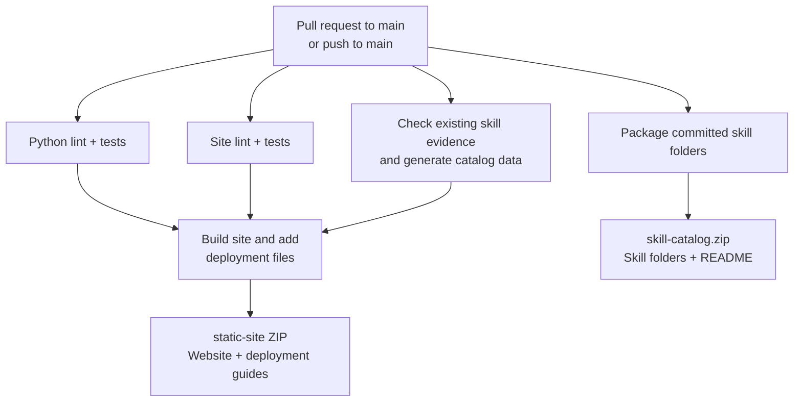
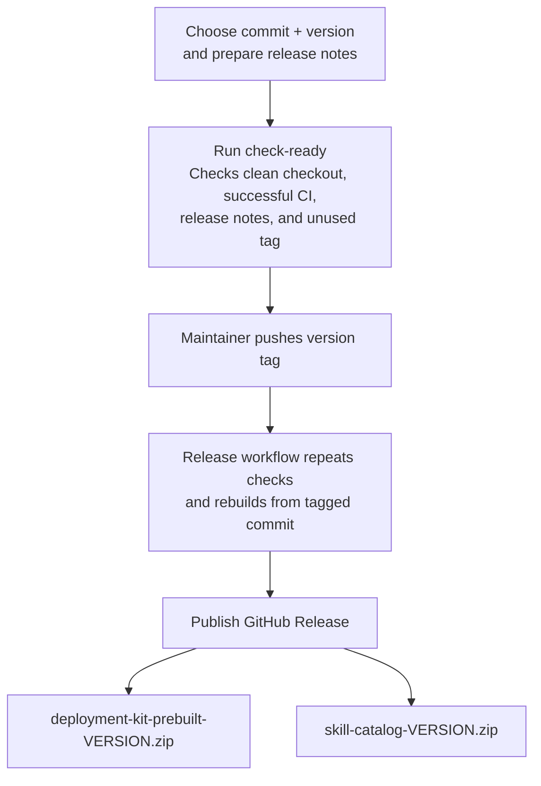

# Skill Exchange CI

Two GitHub Actions workflows validate and publish this repository:

- `.github/workflows/ci.yml` checks proposed changes and builds preview downloads.
- `.github/workflows/release.yml` publishes versioned product downloads when a
  maintainer pushes a release tag.

## GitHub Validation

The `CI` workflow runs on every pull request targeting `main` and every push to
`main`. All jobs use GitHub-hosted Ubuntu runners.



The first four branches run independently. The site build waits for the Python
checks, site checks, and catalog data generation to succeed. The skill catalog
download does not depend on those checks.

The workflow checks and builds the site in three steps:

1. **Check the code.** The Python and site jobs run lint and tests. These are the
   same checks available locally through the `Justfile`. A failed check prevents
   the final site artifact from being uploaded.
2. **Generate catalog data.** The `exchange-data` job uses Python to read the
   tracked bill of evidence (BOE) for each skill. Each BOE must record a successful
   assessment and match the skill's current content exactly. Missing or invalid
   evidence fails the build. CI does not run a scanner or create replacement
   evidence.
3. **Build and package the site.** The `static-site` job downloads the generated
   data and uses Node.js to build `site/dist/`. It then runs
   `python -m skill_exchange.release stage` to assemble the site, deployment
   guides, and GitLab Pages job in a fresh directory under `RUNNER_TEMP`.

The data-generation job checks out the full Git history. It also sets the source
repository and commit used in catalog links. For a pull request, those links
point to the pull request's head commit and repository, including when the
repository is a fork. For a push, they point to the pushed commit. These values
replace the placeholders in the site configuration.

The final job uploads the staged directory as the `static-site` artifact. GitHub
creates the downloadable ZIP and includes hidden files such as `.gitlab-ci.yml`.
Unzip it once to get `public/`, documentation, and the deployment job. The package
has the same layout as a release ZIP. This preview build creates no tag or GitHub
Release.

## Skill Catalog Download

The `skill-catalog` job builds a separate download. It runs independently of the
site checks and build, using `scripts/package-skill-catalog.sh` to create
`skill-catalog.zip`. Releases use the same packaging command.

The ZIP contains the four selected skill folders and their installation README.
The script reads files from the checked-out Git commit, so untracked files and
uncommitted changes are excluded. Packaging requires Git, Bash, and zip.

The job uploads the ZIP with `archive: false`, which tells GitHub to offer the
file directly without wrapping it in another archive. Download `skill-catalog.zip`
and unzip it once to get `skills/` and `README.md`. This is the same layout used
in a release ZIP.

To package the current commit locally, run this from the repository root:

```sh
bash scripts/package-skill-catalog.sh release/skill-catalog.zip
```

## Releases

Passing CI creates preview downloads. Publishing a release requires a maintainer
to push a version tag after checking readiness:



### Check readiness

Follow the [release process](.agents/skills/sklc-release-process/SKILL.md) to agree
on a version and release notes before tagging.

Choose the commit to release and copy its full SHA from GitHub. In a checkout of
that commit, run the readiness check with Python 3.12 and `uv`:

```sh
uv run --group release python -m skill_exchange.release check-ready \
  --version <version> --expected-commit <expected-commit-sha>
```

Provide a token through `GH_TOKEN`. It needs read access to repository contents,
releases (including drafts), and Actions. `GITHUB_TOKEN` is also supported;
`GH_TOKEN` takes precedence when both are set. Keep tokens out of command
arguments and tracked files.

The check confirms that:

- The checkout is clean, matches the expected SHA, and has no unfinished Git
  operation, such as a merge or rebase.
- The release notes are valid and match the requested version.
- The intended tag does not exist locally or on GitHub, and no GitHub Release
  already uses it.
- The candidate commit is in GitHub's `main` history. It can be an older commit;
  the local branch name does not matter.
- The latest `ci.yml` run triggered by a push to `main` for that commit completed
  successfully.

Missing CI results, API errors, or unavailable authentication cause the check to
fail. On success, it prints JSON containing the version, tag, candidate SHA, and
CI run URL. Use that run's `static-site` and `skill-catalog.zip` artifacts to
preview the packages without rebuilding locally.

The check is read-only: it creates no tag or release. If the candidate changes,
run it again. When ready to release, tag the exact SHA reported by the check.

The `release` dependency group installs `pygit2` and `PyGithub`, which the check
uses to read Git and GitHub state. It does not invoke Git, `gh`, or `jq`
subprocesses.

### Publish a release

The release workflow starts when a maintainer pushes a `v<version>` tag. The
tagged commit must contain exactly one nonempty `## <version>` section in
`RELEASE_NOTES.md`. Headings inside fenced Markdown examples do not count. The
matching section becomes the GitHub Release body.

The workflow runs the Python and site checks, generates catalog data from tracked
BOE that matches each skill's content, and builds the site. Missing evidence fails
the build without running a scanner. The workflow then packages and publishes
two assets under the same version:

- `deployment-kit-prebuilt-<version>.zip`
- `skill-catalog-<version>.zip`

GitHub displays a SHA-256 digest for each asset. Download the ZIP you need,
calculate its SHA-256, and compare it with the digest shown by GitHub before
unzipping. See the
[GitHub digest announcement](https://github.blog/changelog/2025-06-03-releases-now-expose-digests-for-release-assets/)
for background.

Publication uses `gh release create --verify-tag`, which requires an existing tag
and does not overwrite an existing release. Versions with a SemVer prerelease
suffix are marked as GitHub prereleases.

The release job runs on GitHub-hosted Ubuntu with a 30-minute timeout. Runs for
the same tag share a concurrency group; a new run does not cancel a release
already in progress. Temporary files stay under `RUNNER_TEMP`, and catalog source
links point to the tagged commit. Checkout does not retain Git credentials, and
`GH_TOKEN` is available only to the publishing step.

## Prebuilt Deployment

The GitLab Pages template at
`products/deployment-kit/ci/gitlab/prebuilt/.gitlab-ci.yml` publishes the package's
existing `public/` directory. It requires a Linux runner that can run job images
and has the tag configured in `PAGES_RUNNER_TAG`.

The job image must provide a POSIX shell; Python and build tools are not required.
By default, the job uses `alpine:3.24.2`. To use another image, such as one from an
internal registry, set these project or group CI/CD variables:

- `PAGES_IMAGE_REGISTRY`, `PAGES_IMAGE_REPOSITORY`, and `PAGES_IMAGE_TAG` to select
  the registry, repository, and tag.
- `PAGES_IMAGE` to override the complete image reference.

The `static-site` CI download can be deployed the same way because it has the
same package layout. It remains a test build, not a published product release.

## Dependency Vulnerability Management

GitHub Dependabot tracks dependency vulnerabilities. Keep its alerts and security
updates enabled in repository settings, and use GitHub Security as the single
alert backlog. Do not add a scheduled CI job that duplicates Dependabot.

The configuration in `.github/dependabot.yml` covers two dependency groups:

- **Python:** the root `pyproject.toml` and `uv.lock`, using the `uv` ecosystem.
- **Site:** `site/package.json` and `site/package-lock.json`, using the `npm`
  ecosystem.

Dependabot checks for version updates every Monday. It groups minor and patch
updates by ecosystem and opens separate pull requests for major updates. It uses
its default dependency and ecosystem labels and assigns update pull requests to
`Fnorgh2`.

`Fnorgh2` owns alert triage and must receive GitHub notifications for high and
critical alerts. Those alerts are reviewed when received; the rest of the
backlog is reviewed weekly. Alerts that cannot be fixed promptly are escalated
to repository administrator `scotluns`.
