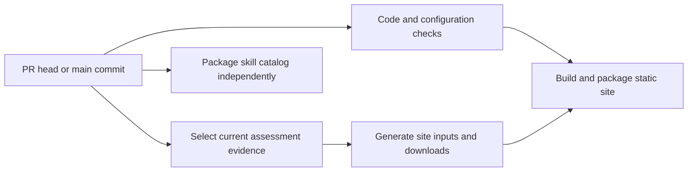

# Validation, previews, and releases

SkLC has two upstream GitHub workflows. **CI** checks proposed changes and creates development previews. **Release** builds versioned downloads from a tag and prepares an unpublished GitHub Release for a maintainer to publish.

Customer GitLab pipelines run the downloaded products in the customer's environment. They are separate from these upstream workflows; use the [Prebuilt](products/deployment-kit/prebuilt/docs/deploy-gitlab-pages.md) or [Operator](products/deployment-kit/operator/docs/README.md) guide for deployment.

Choose the section for your task:

- [Understand a PR or main build](#github-validation).
- [Find a preview download](#preview-downloads).
- [Understand assessment jobs and their configuration](#main-catalog-assessments).
- [Prepare and publish a release](#releases).
- [Handle dependency alerts](#dependency-vulnerability-management).

## GitHub Validation

CI and release jobs select Node.js with `>=22.23.4 <23`, matching the minimum required by Astro 7.4.2 and excluding older cached Node 22 versions. Operator builds default to `node:22.23.4`; a custom `NODE_IMAGE` must provide Node.js >=22.23.4 and npm.

[ci.yml](.github/workflows/ci.yml) runs on every pull request, including stacked PRs targeting another branch, and pushes to `main`. PR checks and previews use the PR head commit. All product builds are attempted regardless of changed paths; provider assessment is conditional on the source and skill changes described below.

The site preview depends on three kinds of work:



| Check area | What it covers |
| --- | --- |
| Python | Ruff and pytest. |
| Site | TypeScript, typed ESLint with React/Astro rules, Astro diagnostics, and site tests. |
| Documentation | Markdown structure and formatting. Catalog skills remain excluded from formatting pending refreshed assessments, but are checked by Markdownlint. |
| Workflows | actionlint with ShellCheck for GitHub; script checks for GitLab templates in their consumer layout. |

The GitLab script checks do not call GitLab's remote lint API or prove a pipeline will be created in a consuming project. See [local lint checks](docs/linting.md) for tools, commands, and these limits. Ordinary checks and packaging run on GitHub-hosted Ubuntu; model assessment uses a self-hosted runner.

Python generation verifies that each report pair describes the exact selected skill, that scanner execution succeeded, and that adjudication completed with matching findings. Missing or stale evidence stops generation. Completed negative judgments and nonfatal coverage gaps remain visible advisory results. Generation neither scans nor changes evidence.

Node consumes the generated inputs and builds the website. The final static-site artifact requires generation and all code/configuration check jobs to succeed. A catalog-only download can still be produced independently of the site build.

## Preview downloads

Open a [CI run](https://github.com/Code-dot-mil/SkLC/actions/workflows/ci.yml) for the commit you want to inspect. Its successful packaging jobs provide these downloads:

| Download | Contents and use |
| --- | --- |
| `static-site` | ZIP containing a finished Prebuilt site: `public/`, guides, and hidden `.gitlab-ci.yml`. Unzip once and follow its deployment guide. |
| `skill-catalog.zip` | Four complete skill folders under `skills/` and their installation README. |
| `skill-catalog-assessments.zip` | README and one unchanged JSON report pair per selected skill. |
| `skill_assessment-*.whl` | Standalone assessment CLI; SkillSpector is installed separately. |
| `deployment-kit-operator-*.zip` | Operator runtime, site source, CI, bundled wheel, and included upstream skills/evidence. |

These are development previews, not published releases. The ZIPs have the same layouts as their release counterparts. GitHub wraps the staged static-site directory as a ZIP; the other product ZIPs are offered directly without a second archive layer. Hidden deployment files are included.

Catalog packaging reads committed content from one pinned snapshot, excluding untracked files and uncommitted edits. Changed-skill PR previews combine the source and matching reports from that same run. Preview generation will not silently substitute an older report for a changed skill.

For a local catalog archive from the current commit, run from the repository root:

```sh
PYTHONPATH=maintainer/src python -m sklc_maintainer.packaging catalog --output release/skill-catalog.zip
```

The `sklc_maintainer.packaging` CLI also owns `assessments`, `operator`, and `prebuilt` assembly. Use its `--help` for input options. Products own their runtime behavior; [product boundaries](docs/product-boundaries.md) explains the separation from upstream packaging.

## Main catalog assessments

The assessment jobs exist to give reviewers usable feedback and keep published evidence matched to current skills. They invoke the public assessment kit from the checkout rather than introducing another report interpretation.

| Source | Assessment behavior | Source-control changes |
| --- | --- | --- |
| Push to `main` | Assess the catalog in LLM-assisted mode; reuse eligible unchanged reports. | Commit only current JSON pairs after all assessments succeed; prune obsolete reports. |
| Same-repository PR | Assess changed skill packages, including supporting-file changes and deletions within a surviving package. | None. Reports, diagnostics, and summaries are temporary artifacts. |
| Fork PR | Skip provider assessment and the self-hosted runner; show a skip notice. | None. Preview generation uses tracked evidence and fails freshness checks if changed skills lack matching reports. |

Deleting an entire package records its removal without scanning it. Unrelated PR changes need no scanner installation or provider requests. Main assessment stops on its first failure; PR assessment continues selected packages so its summary can retain partial results.

On main, `--if-changed` is used only when the incoming push left both current JSON files unchanged. Incoming report edits and an initial push force assessment rather than trusting those edits. Successful results live under `products/skill-catalog-assessments/<skill-name>/`. Obsolete report pairs and scanner logs are removed only after all scans succeed; unrelated files are preserved.

Main writes use `GITHUB_TOKEN` with `contents: write`, so branch protection must permit that update. These token-authenticated pushes do not start another push workflow. Main assessment jobs are serialized; if another writer advances the branch, a non-fast-forward push fails without overwriting that work. Available reports and failure diagnostics are retained as artifacts. Site generation uses the report artifact associated with the source revision being built.

### Pull request assessment review

Read the Actions summary or download `pr-assessments`. It includes per-skill `reports/`, Markdown under `summaries/`, and combined `summary.md`. Its NUL-delimited selection manifests distinguish changed packages, including deletions, from packages still present at the PR head. Failed scans retain available diagnostics; incomplete coverage remains explicit.

The PR checkout does not persist Git credentials, and the review job neither commits nor posts comments. Generation stages tracked pairs and replaces changed entries with the PR's reports. Missing changed entries stop the preview rather than reusing stale evidence.

### Configure the assessment runner

The self-hosted runner needs Bash, Git, Python, pip, and access to the scanner's source/package dependencies and selected provider. The workflow selects Python 3.12, installs uv, and installs SkillSpector in a temporary environment. Configure these Actions values:

| Setting | Where and why |
| --- | --- |
| `SCANNER_SOURCE` | Required variable: a pip requirement pinned to an immutable SkillSpector revision. The documented source is 2.10.0 at NVIDIA commit `e29b16d305b0e738e3d4b952ba102f5522a6f084`. |
| `SKILLSPECTOR_PROVIDER`, `SKILLSPECTOR_MODEL` | Variables choosing the provider and explicit model. |
| Provider URL/deployment/API-version settings | Variables for the selected gateway, as below. |
| Provider API key | Matching Actions secret; never skill content or download contents. |
| `RUNNER_CA_BUNDLE_PATH` | Optional runner certificate-bundle path, supplied as `SSL_CERT_FILE` and `NODE_EXTRA_CA_CERTS`. |

The workflow passes `OPENAI_BASE_URL`/`OPENAI_API_KEY`, the `SKILLSPECTOR_COMPAT_*` URL/key pair, and Azure endpoint/key/deployment/API-version settings. For Azure, use the native `azure_openai` provider and its gateway root. Consult [adjudication gateways](products/assessment-kit/README.md#adjudication-gateways) for required settings. The workflow does not expose every optional local CLI setting; its environment block is the configuration reference.

Both main and PR jobs set `SKILL_ASSESSMENT_BASE_DIR` to the checkout root. This shortens matching native `skill.source` paths; it does not redact logs or other report content. Scanner pacing, output limits, and workflow budgets use upstream defaults; legacy custom pacing/token-cap/scan-budget variables are not consumed.

## Releases

A release is a versioned set of consumer downloads. It has three stages: **check a candidate → prepare a draft → verify and publish that draft**. All commands below run from the candidate checkout's repository root. This procedure describes the workflow; running a readiness check alone does not publish anything.

The maintainer responsible for the release agrees on the version and notes and authorizes the tag push and publication. One request can authorize both stages. The technical gates verify state; they do not supply that authorization. This guide does not prescribe a separate approval-record format.

### Choose the candidate and version

Agree on the version and consumer-facing release notes. Use a SemVer version without `v` in commands and a `v<version>` Git tag. Commit exactly one nonempty `## <version>` section in `RELEASE_NOTES.md`; that section becomes the release body. Set the assessment-kit version in `products/assessment-kit/pyproject.toml` to correspond under Python packaging normalization, for example `1.2.3-rc.1` → `1.2.3rc1`.

Select the intended commit in GitHub and copy its full 40-character SHA. Use a clean checkout of that commit, Python 3.12, and uv. Set `GH_TOKEN` with read access to contents, draft releases, and Actions. `GITHUB_TOKEN` is also supported; `GH_TOKEN` takes precedence. Keep credentials out of command arguments and tracked files.

### Check readiness

```sh
uv run --group release python -m sklc_maintainer.release check-ready   --version <version> --expected-commit <expected-commit-sha>
```

This read-only gate checks the clean checkout and notes, that the candidate belongs to main history, that the tag/version is unused locally and on GitHub, and that the latest main-push CI run for that commit succeeded. An older commit in main history can qualify; the local branch name is immaterial.

On success, it prints JSON with the candidate SHA and CI URL. Use that run's [product previews](#preview-downloads) to inspect the relevant packages if needed. Missing authentication, API access, or successful CI blocks readiness. If the candidate changes, repeat the check before tagging.

An assessment-bot commit can be newer than the last push-triggered CI run because its token does not start another workflow. That commit is not verified for release: a PR run or a successful run for its parent does not satisfy the exact-SHA main-push requirement. Resolve candidate verification before tagging; do not change evidence or bypass the gate.

### Prepare a draft

After readiness succeeds and the release is authorized, tag its exact reported commit and push that tag:

```sh
git tag v<version> <candidate-sha>
git push origin refs/tags/v<version>
```

The tag starts [release.yml](.github/workflows/release.yml). The workflow validates the version and notes, reruns Python lint/tests and site lint/tests, generates from committed matching assessments, builds the site, and assembles exactly five assets:

| Asset | Consumer purpose |
| --- | --- |
| `deployment-kit-prebuilt-<version>.zip` | Deploy the finished example website. |
| `deployment-kit-operator-<version>.zip` | Build and deploy a maintained catalog. |
| `skill-catalog-<version>.zip` | Install the supplied skills. |
| `skill-catalog-assessments-<version>.zip` | Read those skills' assessment pairs. |
| `skill_assessment-<version>-py3-none-any.whl` | Install the standalone assessment CLI; its version uses Python normalization. |

Release generation runs no scanner. Missing or stale committed evidence fails the build. The job runs on GitHub-hosted Ubuntu with a 30-minute timeout; runs for the same tag are serialized without cancelling preparation already underway. Catalog contents come from the tagged commit. Temporary packaging files stay under `RUNNER_TEMP`, checkout credentials are not retained, and the draft-creation credential is scoped to its upload step.

Wait for preparation to finish. The workflow creates the unpublished draft and uploads its assets; do not create a competing draft or upload locally repackaged previews. Existing tags, partial drafts, or failed preparation need investigation and agreed recovery before moving tags or replacing assets. SemVer prerelease suffixes mark the draft as a GitHub prerelease.

### Check and publish the draft

From the same clean candidate checkout:

```sh
uv run --group release python -m sklc_maintainer.release check-draft   --version <version> --expected-commit <expected-commit-sha>
```

This gate requires the existing tag to resolve to the candidate, an unpublished draft with matching notes and prerelease status, all **four ZIPs and the assessment wheel** uploaded and nonempty with GitHub SHA-256 digests, and a successful release-workflow run for that tag/commit. It prints the candidate, draft/workflow URLs, and asset digests without downloading or changing the assets. API errors, missing assets, or unfinished/failed runs block publication.

Use `check-draft` after tag creation, rather than rerunning `check-ready`, which expects an unused version. When publication is authorized, publish that existing draft:

```sh
gh release edit v<version> --repo Code-dot-mil/SkLC --draft=false
```

Publication reuses the prepared assets and existing tag; it does not rebuild them or trigger another tag-push workflow. Consumers verify each downloaded asset against its GitHub SHA-256 digest before unpacking a ZIP or installing a wheel.

The [release-process skill](.agents/skills/sklc-release-process/SKILL.md) supplies agent-specific handling for readiness, draft, and publication requests. Release tooling is validated through actual release use rather than throwaway releases or additional release-script tests.

## Dependency Vulnerability Management

GitHub Security is the dependency-alert backlog. Dependabot covers the root uv project/lockfile and the Operator site's npm manifest/lockfile. Weekly version checks run on Monday; minor and patch updates are grouped by ecosystem, while major updates get separate PRs. See [dependabot.yml](.github/dependabot.yml).

`Fnorgh2` owns triage and notifications for high/critical alerts, which are reviewed when received; the rest of the backlog is reviewed weekly. Unresolved alerts are escalated to repository administrator `scotluns`. Keep Dependabot alerts and security updates enabled and handle remediation in this backlog rather than duplicating it with another scheduled CI job.
