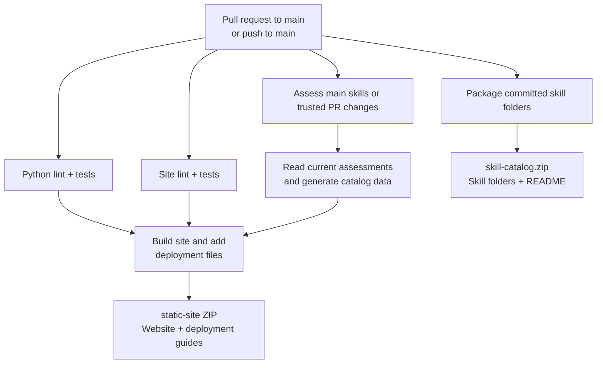
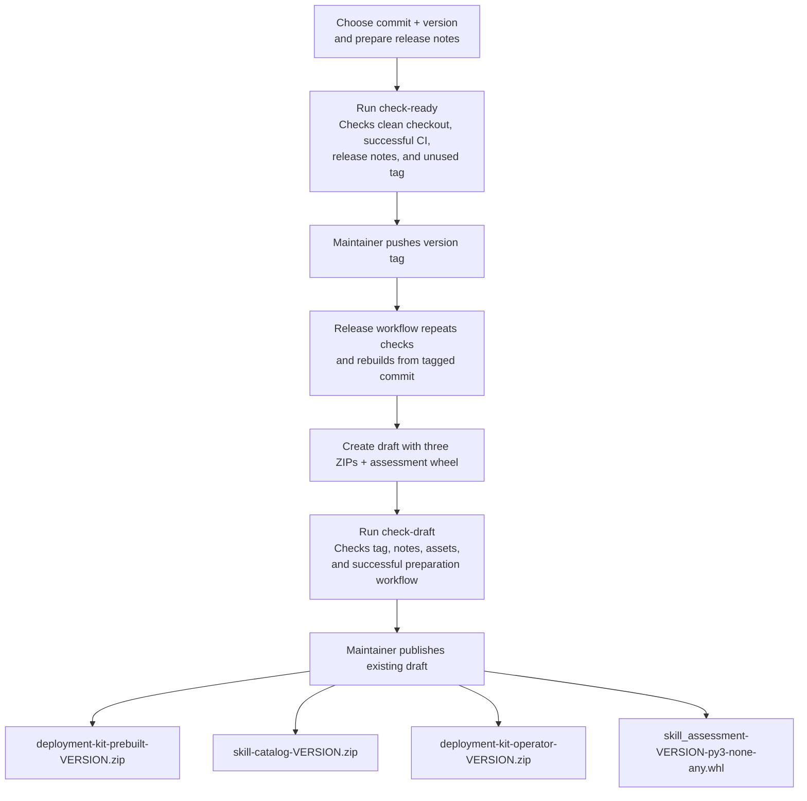

# Skill Exchange CI

Two GitHub Actions workflows validate and prepare releases for this repository:

- `.github/workflows/ci.yml` checks proposed changes and builds preview downloads.
- `.github/workflows/release.yml` prepares a draft with versioned product downloads
  when a maintainer pushes a release tag. The maintainer publishes the existing draft.

## GitHub Validation

The `CI` workflow runs on every pull request targeting `main` and every push to
`main`. Validation and packaging use GitHub-hosted Ubuntu runners; provider
assessment jobs use a self-hosted runner.



Code checks and product packaging run independently. Data generation waits for
the relevant main or trusted-PR assessment job; the site build also waits for code
checks. Fork previews use tracked reports and fail freshness checks when changed
skills lack matching current evidence. They make no provider calls.

The workflow checks and builds the site in three steps:

1. **Check the code.** The Python and site jobs run lint and tests. These are the
   same checks available locally through the `Justfile`. A failed check prevents
   the final site artifact from being uploaded.
2. **Generate catalog data.** The `exchange-data` job stages current assessments
   from tracked reports and the preceding assessment job's artifact. Python
   verifies the shared package hash, usable native execution, completed
   adjudication, and paired findings. Missing, stale, or mismatched reports fail
   generation; nonfatal partial coverage and negative safety judgments remain
   visible. Generation runs no scanner or provider and writes no evidence.
3. **Build and package the site.** The `static-site` job downloads the generated
   data and uses Node.js to build `site/dist/`, with the generated directory selected
   explicitly through `SKILL_EXCHANGE_GENERATED_ROOT`. It then runs
   `python -m sklc_maintainer.packaging prebuilt --stage` to assemble the site, deployment
   guides, and GitLab Pages job in a fresh directory under `RUNNER_TEMP`.

The final job uploads the staged directory as the `static-site` artifact. GitHub
creates the downloadable ZIP and includes hidden files such as `.gitlab-ci.yml`.
Unzip it once to get `public/`, documentation, and the deployment job. The package
has the same layout as a release ZIP. This preview build creates no tag or GitHub
Release.

## Main catalog assessments

Upstream policy lives in `sklc_maintainer.assessments`: `select` writes the
NUL-delimited package manifests, `assess` invokes the public assessment CLI,
`prune` removes obsolete reports only after successful main assessment, and
`summarize` combines retained PR summaries. The workflow keeps these phases,
runner/credential conditions, artifacts, and pair-only Git writes visible.
Selection uses the existing flat package paths; validation, hashing and report
interpretation stay in assessment-kit. An existing empty catalog selects no
packages and permits obsolete-report cleanup; a missing root or invalid comparison
commit fails. Main assessment stops at the first failure; PR assessment continues
the selected packages and retains partial results for its always-run summary.

The independent `catalog-assessments` job runs only for pushes to `main`. Its
self-hosted runner must provide Bash, Python, pip, and SkillSpector `>=2.10,<3`
on `PATH`. The job selects Python 3.12, installs uv, and invokes the checked-out
assessment kit with explicit `--scan-mode llm-assisted`. Main passes `--if-changed`
only when the incoming push left both current JSON files unchanged; incoming pair
edits and an initial push force an independent scan. Both main and PR assessment
jobs set `SKILL_ASSESSMENT_BASE_DIR` to the checkout root. This rewrites only matching
native `skill.source` prefixes; it does not redact diagnostic scanner logs.

Configure `SKILLSPECTOR_PROVIDER`, `SKILLSPECTOR_MODEL`, and the selected gateway's
variables and credential secrets described in the
[assessment kit](products/assessment-kit/README.md#adjudication-gateways).
`RUNNER_CA_BUNDLE_PATH` supplies the runner's optional custom certificate bundle.
Credentials remain in Actions secrets; no provider-specific settings are embedded
in skill content or customer downloads.

Successful current reports are committed only under
`products/skill-catalog-assessments/<skill-name>/`. After all scans succeed, the current JSON pair and any
diagnostic scanner log are removed from obsolete skill directories; unrelated files
are preserved and empty obsolete directories are removed. The job uses `GITHUB_TOKEN` with `contents: write`; its push
[does not trigger another workflow run](https://docs.github.com/en/actions/concepts/security/github_token).
Repository branch protection must permit that write. Concurrent assessment jobs
are serialized; if another writer advances main, a non-fast-forward push fails
without overwriting their work. Reports and failure diagnostics are uploaded even
when the job fails. When conditional reuse applies, valid unchanged reports skip
without another provider call.

Site generation consumes the main job's current-report artifact for that same
source revision. Node jobs consume Python-generated artifacts.

## Pull request assessment review

Same-repository PRs run a read-only assessment review on the configured assessment
runner. Changes anywhere inside a skill package, including supporting files and
deleted files, select that package. Deleted skill packages are recorded but do not
invoke the scanner. Unrelated changes skip scanner setup and provider requests.
Fork PRs receive an explicit skipped notice on a hosted runner, with no assessment
runner or provider credentials. The workflow uses `pull_request`, checks out the PR
head without persisted Git credentials, and never commits or posts comments.

The `pr-assessments` artifact contains temporary `reports/<skill-name>/` outputs,
mirrored `summaries/` Markdown, combined `summary.md`, and NUL-delimited manifests:
`changed-skills.nul` includes deletions; `current-skills.nul` selects packages still
present in the PR head. The combined Markdown also appears in the Actions summary.
Failed scans retain their diagnostics; action summaries preserve partial coverage.

Preview generation copies tracked current reports into a temporary directory,
then replaces changed entries with `reports/<skill-name>/` from the PR artifact.
Missing changed reports fail the copy instead of reusing stale tracked evidence.
Removed packages are absent from PR source discovery. Generation reads the PR
head, matching the revision assessed by the review job.

Provider configuration is shared with the main job through a YAML anchor, a
[supported workflow facility](https://docs.github.com/en/actions/reference/workflows-and-actions/reusing-workflow-configurations#yaml-anchors-and-aliases).

## Skill Catalog Download

The `skill-catalog` job builds a separate download. It runs independently of the
site checks and build, using `python -m sklc_maintainer.packaging catalog` to create
`skill-catalog.zip`. Releases use the same packaging command.

The ZIP contains the four selected skill folders and their installation README.
One committed catalog selection supplies the skill names for both catalog and
assessment downloads. Each packaging invocation pins HEAD once and reads owned
source from that snapshot, excluding untracked files and uncommitted changes.
Packaging requires Git and Python 3.12 or later; catalog, assessment and Prebuilt
packaging use only the standard library.

The job uploads the ZIP with `archive: false`, which tells GitHub to offer the
file directly without wrapping it in another archive. Download `skill-catalog.zip`
and unzip it once to get `skills/` and `README.md`. This is the same layout used
in a release ZIP.

To package the current commit locally, run this from the repository root:

```sh
PYTHONPATH=maintainer/src python -m sklc_maintainer.packaging catalog --output release/skill-catalog.zip
```

Assessment packaging uses the same committed catalog selection and copies the current
JSON pairs unchanged. Its explicit `--source-dir` option accepts staged CI reports.
Operator assembly consumes the catalog ZIP, assessment ZIP, and exact wheel through
`sklc_maintainer.packaging operator`. Prebuilt assembly consumes a static site build;
`--stage` prepares CI's directory artifact and `--version` creates the release ZIP.
Release checks and draft verification stay in `sklc_maintainer.release`.

## Releases

Passing CI creates preview downloads. Release preparation and publication are
separate stages:



### Check readiness

Follow the [release process](.agents/skills/sklc-release-process/SKILL.md) to agree
on a version and release notes before tagging.

Choose the commit to release and copy its full SHA from GitHub. In a checkout of
that commit, run the readiness check with Python 3.12 and `uv`:

```sh
uv run --group release python -m sklc_maintainer.release check-ready \
  --version <version> --expected-commit <expected-commit-sha>
```

Provide a token through `GH_TOKEN`. It needs read access to repository contents,
releases (including drafts), and Actions. `GITHUB_TOKEN` is also supported;
`GH_TOKEN` takes precedence when both are set. Keep tokens out of command
arguments and tracked files.

The check confirms that:

- The checkout is clean, matches the expected SHA, and has no unfinished Git
  operation, such as a merge or rebase.
- The release notes are valid and match the requested version.
- The intended tag does not exist locally or on GitHub, and no GitHub Release
  already uses it.
- The candidate commit is in GitHub's `main` history. It can be an older commit;
  the local branch name does not matter.
- The latest `ci.yml` run triggered by a push to `main` for that commit completed
  successfully.

Missing CI results, API errors, or unavailable authentication cause the check to
fail. On success, it prints JSON containing the version, tag, candidate SHA, and
CI run URL. Use that run's `static-site` and `skill-catalog.zip` artifacts to
preview the packages without rebuilding locally.

The check is read-only: it creates no tag or release. If the candidate changes,
run it again. When ready to release, tag the exact SHA reported by the check.

The `release` dependency group installs `pygit2` and `PyGithub`, which both gates
use to read Git and GitHub state. The gates do not invoke Git, `gh`, or `jq`
subprocesses. Use their results instead of repeating their checks manually.

### Prepare a draft

The release workflow starts when a maintainer pushes a `v<version>` tag. The
tagged commit must contain exactly one nonempty `## <version>` section in
`RELEASE_NOTES.md`. Headings inside fenced Markdown examples do not count. The
matching section becomes the GitHub Release body.

After a successful `check-ready`, create and push the tag at the exact reported SHA:

```sh
git tag v<version> <candidate-sha>
git push origin refs/tags/v<version>
```

This creates the public tag and starts release preparation; it does not publish
the release. The workflow runs the Python and site checks, generates catalog
data from tracked BOE that matches each skill's content, and builds the site. Missing evidence fails
the build without running a scanner. The workflow then creates an unpublished
draft containing exactly four assets under the same version:

- `deployment-kit-prebuilt-<version>.zip`
- `deployment-kit-operator-<version>.zip`
- `skill-catalog-<version>.zip`
- `skill_assessment-<version>-py3-none-any.whl`

The assessment-kit package version must match the release version under Python
packaging normalization (for example, `1.2.3-rc.1` becomes `1.2.3rc1`). Set
`products/assessment-kit/pyproject.toml` accordingly before selecting the release
candidate. The workflow builds the wheel with `uv build` and uploads it alongside
the ZIPs. The wheel does not install SkillSpector.

Draft creation uses `gh release create --verify-tag --draft`, which requires an
existing tag and does not overwrite an existing release. Versions with a SemVer
prerelease suffix are marked as GitHub prereleases.

The release job runs on GitHub-hosted Ubuntu with a 30-minute timeout. Runs for
the same tag share a concurrency group; a new run does not cancel a release
already in progress. Temporary files stay under `RUNNER_TEMP`, and catalog source
links point to the tagged commit. Checkout does not retain Git credentials, and
`GH_TOKEN` is available only to the draft-creation step.

Wait for the workflow to finish before publishing. The workflow owns packaging,
draft creation, and uploads. Do not separately create a draft or upload locally
repackaged CI previews. If preparation fails, inspect that run and resolve its
failure before proceeding. An existing tag or partial draft is a recovery case;
do not move tags or replace assets without agreeing on recovery.

### Check and publish the draft

Once the preparation run succeeds, run the draft gate from the clean candidate
checkout, using the same version and expected SHA:

```sh
uv run --group release python -m sklc_maintainer.release check-draft \
  --version <version> --expected-commit <expected-commit-sha>
```

The gate verifies the checkout and committed notes, confirms the GitHub tag
resolves to the expected commit on `main`, and requires an existing draft with
matching notes and prerelease status. That draft must contain exactly the two
versioned product ZIPs and the assessment wheel, all uploaded,
nonempty, and carrying GitHub SHA-256 digests. The latest `release.yml` push run
for the tag and commit must have completed successfully. Missing authentication, API errors, missing assets, and
unfinished or failed runs block publication.

On success, it prints the candidate SHA, draft URL, workflow URL, and asset
digests. It does not download the assets or change GitHub state. `check-ready`
is for an unused version; `check-draft` is for an existing draft. Do not rerun
`check-ready` after creating the tag or draft.

After reviewing the draft, publish it with:

```sh
gh release edit v<version> --repo Code-dot-mil/SkLC --draft=false
```

The tag already exists, so this does not trigger another tag-push workflow.
Publication uses the draft's existing assets rather than rebuilding them.

GitHub displays a SHA-256 digest for each asset. Download the product you need,
calculate its SHA-256, and compare it with the digest shown by GitHub before
unzipping a ZIP or installing the wheel. See the
[GitHub digest announcement](https://github.blog/changelog/2025-06-03-releases-now-expose-digests-for-release-assets/)
for background.

Release-script changes are validated through release use; do not add automated
tests or create throwaway releases for them. Open Dependabot findings can be
briefly investigated and discussed in the maintainer session, without adding a
recorded decision or a separate security or acceptance gate.

## Prebuilt Deployment

The GitLab Pages template at
`products/deployment-kit/ci/gitlab/prebuilt/.gitlab-ci.yml` publishes the package's
existing `public/` directory. It requires a Linux runner that can run job images
and has the tag configured in `PAGES_RUNNER_TAG`.

The job image must provide a POSIX shell; Python and build tools are not required.
By default, the job uses `alpine:3.24.2`. To use another image, such as one from an
internal registry, set these project or group CI/CD variables:

- `PAGES_IMAGE_REGISTRY`, `PAGES_IMAGE_REPOSITORY`, and `PAGES_IMAGE_TAG` to select
  the registry, repository, and tag.
- `PAGES_IMAGE` to override the complete image reference.

The `static-site` CI download can be deployed the same way because it has the
same package layout. It remains a test build, not a published product release.

## Dependency Vulnerability Management

GitHub Dependabot tracks dependency vulnerabilities. Keep its alerts and security
updates enabled in repository settings, and use GitHub Security as the single
alert backlog. Do not add a scheduled CI job that duplicates Dependabot.

The configuration in `.github/dependabot.yml` covers two dependency groups:

- **Python:** the root `pyproject.toml` and `uv.lock`, using the `uv` ecosystem.
- **Site:** `site/package.json` and `site/package-lock.json`, using the `npm`
  ecosystem.

Dependabot checks for version updates every Monday. It groups minor and patch
updates by ecosystem and opens separate pull requests for major updates. It uses
its default dependency and ecosystem labels and assigns update pull requests to
`Fnorgh2`.

`Fnorgh2` owns alert triage and must receive GitHub notifications for high and
critical alerts. Those alerts are reviewed when received; the rest of the
backlog is reviewed weekly. Alerts that cannot be fixed promptly are escalated
to repository administrator `scotluns`.
