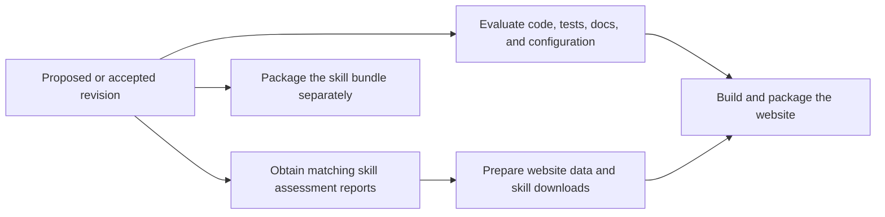

# How SkLC validates changes and prepares releases

When someone proposes a change to SkLC, automated programs look for problems and try to build the products. This helps reviewers see whether the change works before accepting it. To **build** a product is to turn its source files into a usable website or installable package. The automation creates downloadable previews so people can inspect the result.

This guide explains that process for contributors and reviewers, then covers release preparation for maintainers and configuration for administrators. You can read the explanation without running commands. To install an already released product, start with the [README's product guides](README.md#choose-a-starting-point).

## From a proposed change to a download

SkLC uses Git to keep a history of its files. Contributors save revisions as **commits** and work on **branches**, separate lines of development where they can make changes before those changes are accepted. A **pull request (PR)** asks reviewers to bring changes from one branch into another. SkLC's `main` branch holds accepted changes.

**Continuous integration (CI)** means automatically validating changes as people contribute them. A **check** is an automated evaluation of some aspect of a change: for example, running tests to see whether the program produces expected results, or checking documentation formatting. Passing a check means its particular rules passed; it does not establish that the whole change is correct or that a skill is safe.

SkLC uses **GitHub Actions**, GitHub's automation service. A **workflow** is a configured procedure, a **run** is one execution of that procedure, and a **job** is a group of steps within a run. Each **step** performs an action, such as installing a tool or running tests. Jobs can have separate results, which is why a run can show both successful and failed work.

When changes include skills—reusable instructions for AI agents—the automation may also assess those instructions for potential problems. These assessments are separate from tests of SkLC's software.

There are two workflows in this repository:

| Workflow | When it starts | What it produces |
| --- | --- | --- |
| **CI** | A pull request is opened or updated, or commits are pushed to `main`. | Check results, assessment reports when needed, and development-preview downloads. |
| **Release** | A version tag is pushed. A tag is a Git label identifying a particular commit. | An unpublished release draft containing versioned downloads. A maintainer publishes it after verification. |

A change normally progresses through PR review, acceptance into `main`, and eventual selection for a release. A successful CI run creates a preview; it does not publish a release or deploy a website.

The workflows described here maintain SkLC itself on GitHub. Teams hosting an exchange run separate deployment procedures in their own environment. Follow the [Prebuilt deployment guide](products/deployment-kit/prebuilt/docs/deploy-gitlab-pages.md) or [Operator guide](products/deployment-kit/operator/docs/README.md) for that work.

## GitHub validation

The [CI workflow](.github/workflows/ci.yml) runs for every PR, including one targeting another development branch, and for pushes to `main`. For a PR, it uses the latest commit on the proposing branch, also called the **PR head**. Product builds are attempted regardless of which files changed; new model-based skill assessments depend on the changes and where the PR originated.

The work has three parts: evaluate the code and configuration, obtain assessment reports matching the selected skills, and build downloadable products. Some parts run in parallel:



### What the checks evaluate

Tests exercise program behavior and compare the results with expectations. **Linting** inspects files for programming mistakes or violations of documented rules without running the application through a user task. Formatting checks look for inconsistent file layout. These activities complement human review.

| Area | What is evaluated | Tool names shown in jobs and logs |
| --- | --- | --- |
| Python programs | Code rules and automated behavior tests. | Ruff inspects code; pytest runs tests. |
| Website | Code rules, consistency between declared data types and their use, page diagnostics, and behavior tests. | TypeScript, ESLint, Astro, and the site test commands. Astro is the framework used to build the website. |
| Documentation | Markdown structure and formatting. | Markdownlint and Prettier. Bundled skill files are checked by Markdownlint but excluded from formatting to preserve their assessed contents. |
| Automation configuration | GitHub workflow rules and shell commands; scripts in the supplied GitLab deployment templates. | actionlint, ShellCheck, and GitLab script checks. Shell commands are instructions executed by the job's command interpreter. |

The GitLab script checks inspect the templates in the arrangement customers receive. They do not submit them to GitLab's validation service or prove that a customer's project can start a pipeline. A **pipeline** is GitLab's term for an automated run of jobs. See [local lint checks](docs/linting.md) for exact commands and limitations, and [Contributing](CONTRIBUTING.md#local-checks) to run checks before submitting changes.

### Why the website needs assessment reports

A published exchange shows skills alongside their assessment evidence. The build must therefore avoid showing an old report as though it reviewed a changed skill.

An assessment produces two reports: findings from SkillSpector, the scanner that looks for potential problems in a skill, and a contextual AI review called **adjudication**. Website-data generation verifies that the reports match the exact skill contents, that scanning succeeded, and that adjudication completed with corresponding findings. Missing or outdated reports stop generation. Generation reads evidence; it does not run a scan or rewrite the reports.

A completed assessment can report problems or limited coverage and still be included on the website. Including a report makes that evidence visible; it does not approve the skill for use. The [assessment guide](products/assessment-kit/README.md#review-scope) explains what the review covers and what its judgments mean.

Python prepares the website's data and downloads under `products/deployment-kit/operator/.exchange/generated/`, beside `site/`. Node.js, the software runtime used by the site tools, always reads that standard location to build the website; no generated-data environment variable is needed. The final website preview requires this preparation and every code/configuration check job to succeed. The skill bundle is packaged separately, so that download can be available even when the website cannot be built.

### Find a result and decide what to do

Open the PR's checks, or select the relevant run on the [CI Actions page](https://github.com/Code-dot-mil/SkLC/actions/workflows/ci.yml). Confirm that the run belongs to the commit you want to inspect. Open a failed job and its failed step to read the log, the recorded output of its commands.

For a failed test or lint check, use the log to identify whether the affected code or file needs correction, or whether the job could not run its tools. An assessment or website-data failure may instead mean missing provider access, a failed review, or reports that do not match the skills. Read the diagnostics before changing anything; do not edit reports to make them appear current.

A **skipped** job did not run because its conditions were not met. For example, a PR from a fork does not receive a provider-backed assessment. A **fork** is a separate copy of the repository used to propose changes. The assessment rules below explain how that affects previews.

A successful run means the configured work succeeded for that revision. Reviewers still need to judge whether the change meets its purpose, interpret skill findings, and inspect relevant preview downloads.

## Preview downloads

A file retained by a workflow run is called an **artifact** in GitHub Actions. Artifacts include both diagnostic reports and product downloads. A **preview** is a product download from development work; use a published [release](https://github.com/Code-dot-mil/SkLC/releases) when you want a released version.

On the selected CI run's summary page, find the artifacts produced by successful packaging jobs. Not every failed run will have every download. Choose the package for the task you want to try:

| Download | Contents and next step |
| --- | --- |
| `static-site` | A finished Prebuilt website under `public/`, deployment guides, and hidden `.gitlab-ci.yml` configuration. Extract the ZIP once, then follow its deployment guide. |
| `skill-bundle.zip` | Complete skill folders under `skills/` and their installation README. Follow that README to install them. |
| `skill-bundle-assessments.zip` | A README and two JSON reports per selected skill. Follow the README to produce a readable summary. JSON is the structured data format used for these reports. |
| `skill_assessment-*.whl` | The standalone assessment command-line tool. A `.whl` file is an installable Python package; follow the [assessment installation guide](products/assessment-kit/README.md#installation). SkillSpector is installed separately. |
| `deployment-kit-operator-*.zip` | The tools, website source, automation configuration, assessment wheel, and included skills/reports needed to maintain an exchange. Follow its README. |

These have the same layouts as their release counterparts. GitHub turns the staged `static-site` directory into a ZIP. The other product ZIPs are offered directly, without a second archive layer. Hidden deployment files are included; enable hidden-file display if your file browser does not show `.gitlab-ci.yml`.

Bundle packaging reads one saved Git revision, excluding uncommitted edits and files Git does not track. A changed-skill PR preview uses matching reports from that same run. It does not silently substitute an older report for a changed skill.

Contributors who need to package the current commit locally can use the commands under [Local packaging](#local-packaging). You do not need those commands to download CI previews.

## Main bundle assessments

Assessment needs access to a **model provider**, the service hosting the model that reviews skill content. Because that access uses credentials and sends content to the provider, CI treats PRs from this repository differently from PRs originating in a fork.

| Source | What is assessed | Where results go |
| --- | --- | --- |
| Push to `main` | The bundle, reusing eligible unchanged reports. | Current report pairs are committed to the repository only after every assessment succeeds. Obsolete reports are then pruned. |
| PR from a branch in this repository | Changed skill packages, including changes to supporting files. | Temporary reports and summaries attached to the run. The job does not commit them or post PR comments. |
| PR from a fork | No new provider-backed assessment. A notice explains the skip. | Website generation uses reports already tracked in Git. If those do not match changed skills, generation fails. Ask a maintainer to arrange matching evidence before those skills can build; the [assessment guide](products/assessment-kit/README.md#assess) covers producing reports for the changed package. |

Deleting a file within a surviving skill package counts as a skill change. Deleting the entire package records the removal without scanning it. PRs without changed skill packages require no scanner installation or provider requests.

### Pull request assessment review

For a changed-skill PR from this repository, open the **PR assessment review** job and read its summary on the Actions run. For the full files, download `pr-assessments`: `summary.md` combines the results, `summaries/` contains per-skill Markdown explanations, and `reports/` holds reports and available troubleshooting output.

Look for confirmed problems to address, unresolved findings to investigate, and limitations on what was reviewed. Successful execution does not mean the skill has no problems. The job continues across selected skills after a failure so reviewers can see available results rather than losing all feedback.

Website preparation starts from the tracked reports and replaces the changed skills' entries with this run's reports. If a required replacement is missing, preparation fails instead of reusing old evidence. The artifact also contains machine-readable lists of changed packages and packages still present; those lists support automation and are not needed to read the summary.

### How accepted assessments are kept current

On `main`, assessment stops at its first failure. Only after all assessments succeed does automation remove obsolete report pairs and scanner logs and commit updated JSON report pairs under `products/skill-bundle-assessments/<skill-name>/`. Unrelated files are preserved. Available results and failure diagnostics are also retained as run artifacts, and website generation uses the reports from the run for its source revision.

Unchanged skills can reuse eligible reports through the assessment kit's `--if-changed` option. The workflow permits this only when the incoming push did not alter either JSON report. An initial push or incoming edits to reports force assessment rather than trusting the edited evidence.

Automated report commits use GitHub's `GITHUB_TOKEN` credential. Such pushes do not start another push-triggered workflow, which prevents a loop of assessment commits. This also matters when choosing a [release candidate](#check-readiness): a newer report commit may not yet have its own verified CI run. Administrator permissions and concurrent-write behavior are described under [Configure the assessment runner](#configure-the-assessment-runner).

## Releases

A release is a named version with downloads for users. A **release candidate** is the specific commit proposed for that version. Preparation creates a **draft**, an unpublished GitHub Release that a maintainer can inspect before making it available.

The sequence is: select a candidate → verify readiness → prepare a draft → verify and publish that draft. The verification commands below are read-only. They stop when required conditions are missing; they do not create tags, upload files, or authorize publication.

This procedure is for maintainers with Git and command-line experience, Python 3.12, uv for managing Python tools, the GitHub command-line tool `gh`, and appropriate GitHub access. All commands run from the candidate checkout's repository root. A **checkout** is the local copy of a selected revision; a **clean** checkout has no pending file changes. See [Contributing](CONTRIBUTING.md#first-time-setup) for development tools.

The maintainer responsible for the release agrees on the version and notes and authorizes the tag push and publication. One request can authorize both stages. Successful verification establishes technical readiness, not permission to publish; no separate approval-record format is prescribed here.

### Choose the candidate and version

Use a semantic version such as `1.2.3`: the major, minor, and patch numbers communicate the scale of a change. Commands take the version without `v`; its Git tag is `v<version>`. A suffix such as `-rc.1` denotes a prerelease, a version offered before a final release.

Commit exactly one nonempty `## <version>` section in `RELEASE_NOTES.md`; that section becomes the release description. Set the assessment-kit version in `products/assessment-kit/pyproject.toml` to correspond using Python's version spelling, for example `1.2.3-rc.1` becomes `1.2.3rc1`.

Select the intended commit in GitHub and copy its full 40-character **SHA**, the identifier for that Git revision. Use a clean checkout of that commit. Set the `GH_TOKEN` environment variable to a credential with read access to repository contents, draft releases, and Actions. An environment variable is a named setting supplied to a program; keep credentials out of command arguments and tracked files. `GITHUB_TOKEN` is also supported, with `GH_TOKEN` taking precedence.

In the commands below, replace `<version>` with the agreed version and `<expected-commit-sha>` with the identifier copied from GitHub. Later tag commands use `<candidate-sha>` for the identifier returned by verification.

### Check readiness

```sh
uv run --group release python -m sklc_maintainer.release check-ready --version <version> --expected-commit <expected-commit-sha>
```

The command verifies a clean checkout and release notes, that the commit belongs to `main` history, that the version/tag is unused locally and on GitHub, and that the latest CI run triggered by a push to `main` for that exact commit succeeded. An older commit in `main` history can qualify; the local branch name does not matter.

Success prints JSON containing the candidate SHA and CI URL. Inspect the relevant [preview downloads](#preview-downloads) from that run. Missing authentication, API access, or successful CI stops readiness verification. If the candidate changes, repeat verification before tagging. An API is the interface the tool uses to request information from GitHub.

A report-bot commit can be newer than the last push-triggered CI run because its credential does not start another workflow. A successful run for its parent commit, or a PR run for the candidate, does not meet the exact-commit requirement. Resolve candidate verification before tagging; do not alter evidence or bypass the requirement.

### Prepare a draft

After readiness succeeds and release preparation is authorized, label the exact reported commit with the version tag and send that tag to GitHub:

```sh
git tag v<version> <candidate-sha>
git push origin refs/tags/v<version>
```

The tag starts the [Release workflow](.github/workflows/release.yml). It validates the version and notes, reruns Python lint/tests and site lint/tests, generates the website data from committed matching assessments, builds the site, and assembles five downloadable files. GitHub calls files attached to a release **assets**:

| Asset | User purpose |
| --- | --- |
| `deployment-kit-prebuilt-<version>.zip` | Deploy the finished example website. |
| `deployment-kit-operator-<version>.zip` | Build and deploy a maintained catalog. |
| `skill-bundle-<version>.zip` | Install the supplied skills. |
| `skill-bundle-assessments-<version>.zip` | Read those skills' assessment reports. |
| `skill_assessment-<version>-py3-none-any.whl` | Install the assessment command-line tool. Its filename uses Python's normalized version. |

Release preparation runs no scanner, so missing or outdated committed evidence fails the build. Bundle contents come from the tagged commit. Wait for the workflow to finish creating the draft and uploading these files. A prerelease version is marked as a prerelease in GitHub.

The workflow owns draft creation and asset uploads. Do not create a competing draft or substitute locally repackaged previews: doing so would break the connection between the verified commit, workflow, and downloads. Existing tags, partial drafts, or failed preparation need investigation and agreed recovery before moving tags or replacing assets.

### Check and publish the draft

From the same clean candidate checkout:

```sh
uv run --group release python -m sklc_maintainer.release check-draft --version <version> --expected-commit <expected-commit-sha>
```

This command verifies that the tag identifies the candidate; an unpublished draft has the expected notes and prerelease status; all four ZIPs and the wheel are uploaded, nonempty, and have GitHub SHA-256 digests; and the Release workflow succeeded for that tag and commit. A **digest**, also called a checksum, is a calculated identifier for file contents that users can compare to detect a changed or damaged download.

Success prints the candidate, draft/workflow URLs, and asset digests without downloading or changing the assets. API errors, missing assets, or unfinished/failed runs stop verification. Use `check-draft` after creating the tag; `check-ready` expects a version that has not yet been used.

Once verification succeeds and publication is authorized, use the GitHub CLI (`gh`) to publish the existing draft:

```sh
gh release edit v<version> --repo Code-dot-mil/SkLC --draft=false
```

Publication reuses the prepared assets and existing tag. It does not rebuild files or start another tag-push workflow. Users should compare each download's SHA-256 digest with GitHub's value before extracting a ZIP or installing the wheel.

The [release-process skill](.agents/skills/sklc-release-process/SKILL.md) gives an agent instructions for handling readiness, draft, and publication requests.

## Administrator and maintainer reference

The sections below are for people configuring the automation or changing its implementation. They are not prerequisites for reading a PR's results or downloading previews.

### Runners and runtime versions

A **runner** is the machine that executes a workflow job. Ordinary checks, packaging, and release preparation use GitHub-hosted Ubuntu machines. Model-based assessments use a **self-hosted runner**, a machine managed by the repository's administrators, so they can provide the required provider and network access.

CI and Release select Node.js with `>=22.23.4 <23`: at least version 22.23.4, but below 23. This meets Astro 7.4.2's minimum and avoids older cached Node 22 versions. Operator builds default to the container image `node:22.23.4`; a custom `NODE_IMAGE` must provide Node.js >=22.23.4 and npm, its package manager.

The release job has a 30-minute limit. Runs for the same tag execute one at a time without cancelling preparation already in progress. Temporary packaging files use the runner's `RUNNER_TEMP` directory. The release checkout does not retain Git credentials, and the draft-creation credential is supplied only to the upload step.

### Configure the assessment runner

The self-hosted runner needs Bash, Git, Python, pip, and network access to SkillSpector's dependencies and the selected model provider. The workflow selects Python 3.12, installs uv, and installs SkillSpector in a temporary environment.

In GitHub Actions configuration, **variables** hold ordinary settings and **secrets** hold sensitive values such as API keys. Configure these repository values:

| Setting | Where and why |
| --- | --- |
| `SCANNER_SOURCE` | Required variable identifying the SkillSpector package to install. Pin it to an immutable revision so runs use a known scanner. The documented source is 2.10.0 at NVIDIA commit `e29b16d305b0e738e3d4b952ba102f5522a6f084`. |
| `SKILLSPECTOR_PROVIDER`, `SKILLSPECTOR_MODEL` | Variables choosing the provider and explicit model. |
| Provider URL/deployment/API-version settings | Variables telling the scanner and review tool how to reach the selected model service. |
| Provider API key | Matching Actions secret. Never include it in skills or downloads. |
| `RUNNER_CA_BUNDLE_PATH` | Optional path to a certificate bundle used to trust HTTPS connections, supplied as `SSL_CERT_FILE` and `NODE_EXTRA_CA_CERTS`. |

The workflow accepts `OPENAI_BASE_URL`/`OPENAI_API_KEY`, the `SKILLSPECTOR_COMPAT_*` URL/key pair, and Azure endpoint/key/deployment/API-version settings. For Azure, use the native `azure_openai` provider and its gateway root URL. Consult [adjudication gateways](products/assessment-kit/README.md#adjudication-gateways) for required settings; a gateway is the service interface through which the review tool reaches the model. The workflow's environment block lists the settings exposed in CI, which are a subset of the local tool's options.

Both main and PR jobs set `SKILL_ASSESSMENT_BASE_DIR` to the checkout root. This shortens matching `skill.source` paths in reports; it does not remove sensitive content from logs or other fields.

Main report updates use `GITHUB_TOKEN` with `contents: write`. Repository branch-protection rules must allow those writes. Main assessment jobs run one at a time. If another writer advances `main` before the report push, Git rejects that push instead of overwriting the other changes. PR assessment checkouts do not retain Git credentials and do not write repository changes.

### Local packaging

After [development setup](CONTRIBUTING.md#first-time-setup), run this from the repository root to package the current committed bundle:

```sh
PYTHONPATH=maintainer/src python -m sklc_maintainer.packaging bundle --output release/skill-bundle.zip
```

The command creates the ZIP at the given output path. Uncommitted edits are not included. `PYTHONPATH` tells Python where to find the maintainer code. The packaging command also supports `assessments`, `operator`, and `prebuilt`; use `--help` for their inputs. [Product boundaries](docs/product-boundaries.md) explains which components belong in each download.

### Dependency vulnerability management

A **dependency** is an external software package SkLC uses. GitHub Security holds the backlog of alerts about known vulnerabilities in those packages. Dependabot, GitHub's dependency-update service, monitors the root Python project and its locked package versions, plus the Operator website's npm package files. See [dependabot.yml](.github/dependabot.yml).

Version checks run weekly on Monday. Minor and patch updates are grouped by package ecosystem; major updates receive separate PRs. `Fnorgh2` reviews high/critical alerts when received and the remaining backlog weekly. Unresolved alerts are escalated to repository administrator `scotluns`. Keep Dependabot alerts and security updates enabled and manage remediation there, rather than creating a second scheduled CI job for the same backlog.
