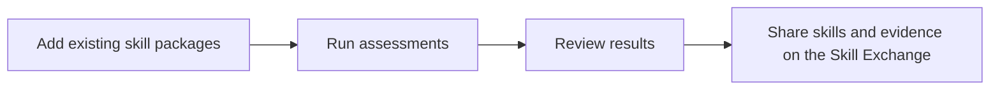

# SkLC

The Skill Lifecycle (SkLC) project provides tools to assess **agent skills**, investigate potential problems, and share skills alongside their assessment evidence.

An **AI agent** is an AI application that can carry out tasks using instructions and tools. A **skill** gives an agent reusable instructions for a particular task. For example, a team could write a skill to help an agent check a document against a checklist, so people do not have to explain the same process each time.

The **Skill Exchange** is a website where people can browse skills, read their instructions and assessment results, and download them for use with a compatible agent.

**New to AI agents or skills?** Start with [Using a skill](docs/using-skills.md) to understand what you need, how to choose a skill, and what to check before relying on its results. You can read about skills without installing software.

## The skill lifecycle

A skill needs more than useful instructions. Its authors need to understand who will use it, check that it behaves as intended, decide when it is ready to share, and revisit those decisions as the skill, model, or environment changes.

The Skill Lifecycle organizes that work into five stages:

| Stage | What it accomplishes |
| --- | --- |
| **Define** | Establish the problem, intended users, expected behavior, and who is responsible for the skill. |
| **Build** | Write the instructions and add the examples, scripts, or other supporting material the task needs. |
| **Validate** | Check when the skill activates, the quality of its results, and potential safety or security problems. Gather evidence for the release decision. |
| **Release** | Decide whether a version is ready for its intended users and make it available with the relevant review evidence. |
| **Operate** | Collect feedback, investigate failures, and reassess the skill as its dependencies, models, or operating conditions change. Update or retire it when needed. |

These stages form a cycle. Feedback during use—or a problem found during validation—can send a skill back for further definition, changes, and testing.

The tools in this repository support parts of that lifecycle. The assessment kit helps gather validation evidence, while the skill bundle and deployment kits help distribute skills and assessment reports. Teams remain responsible for task-specific testing, release decisions, and ongoing review.

## Choose a starting point

You can install skills, run assessments, or host an exchange independently. Start with the task you want to accomplish.

| Your goal | What to use | Guide |
| --- | --- | --- |
| Install the supplied skills | **Skill bundle** — complete skill packages | [Install skills for your agent](products/skill-bundle/README.md) |
| Assess a skill you wrote or received | **Assessment kit** — a standalone Python command-line tool | [Install the kit and assess a local skill](products/assessment-kit/README.md) |
| Put the supplied example exchange online | **Prebuilt deployment kit** — a ready-to-host website | [Install the site](products/deployment-kit/prebuilt/docs/install.md), then deploy to [GitLab Pages](products/deployment-kit/prebuilt/docs/deploy-gitlab-pages.md) or [another static host](products/deployment-kit/prebuilt/docs/deploy-static-hosting.md) |
| Publish an exchange containing your team's skills | **Operator deployment kit** — assessment tooling, website source, and a GitLab pipeline | [Set up and maintain your exchange](products/deployment-kit/operator/docs/README.md) |

Download the package for your chosen path from [GitHub Releases](https://github.com/Code-dot-mil/SkLC/releases). To assess a skill yourself, download `skill_assessment-<version>-py3-none-any.whl`. To read the supplied skills’ existing reports and summaries, download `skill-bundle-assessments-<version>.zip`. Follow the package guide to compare the download's SHA-256 checksum with the value displayed on the release page. The guides also cover required tools, package contents, and how to verify a successful installation or deployment. See [Architecture](docs/architecture.md) for how the downloads fit together.

## Using the skill bundle

Use the bundle to install the supplied skills in a compatible agent. The [bundle installation guide](products/skill-bundle/README.md) lists the included skills and explains how to install them. Using the bundle requires neither a hosted exchange nor assessment tooling.

## Using the assessment kit

The assessment kit helps an author investigate potential problems before using or sharing a skill. It runs the external **SkillSpector** scanner and, by default, asks a configured model to review the findings in context. After SkillSpector reports its findings, the model judges whether each one is a real issue, a false positive, or needs more investigation. This step is called **adjudication**. Skill contents are sent to the configured model provider.

The kit produces a scanner report and an adjudication report. Its `summarize` command turns that pair into a readable account of confirmed problems to address, findings that still need investigation, alerts dismissed after contextual review (judged to be false positives), and review limitations. After revising a skill, assess it again to check the new content. See the [assessment guide](products/assessment-kit/README.md) for prerequisites, commands, and result interpretation.

An assessment is evidence for a human decision, not a safety certificate. SkillSpector scans the skill folder and reports its findings and coverage. The adjudication model reads `SKILL.md` and the scanner report, which can include evidence about supporting files. A successful command can still report problems or incomplete coverage. Read the [review scope](products/assessment-kit/README.md#review-scope) before relying on a judgment.

## Share skills through an exchange

An exchange lets visitors browse skill descriptions, read instructions and assessment results, and download skill packages and reports.

Choose **Prebuilt** to host the supplied example exchange without building the site. Choose **Operator** to maintain your own catalog, select any supplied skills you want to include, and run the assessment, build, and publication pipeline. Operator setup requires GitLab runners, an assessment container image, and access to a configured model provider. The [Operator guide](products/deployment-kit/operator/docs/README.md) walks through those requirements and ongoing updates.

[Governance](GOVERNANCE.md) describes human review and approval responsibilities.

## Explore the project or contribute

- [Contributing](CONTRIBUTING.md) covers source development, tool installation, local checks, and generated files.
- [CI and releases](CI.md) explains validation, development-preview downloads, and release preparation.
- [Product decisions](docs/decisions.md) records accepted requirements and the parallel lifecycle-guidance direction.
