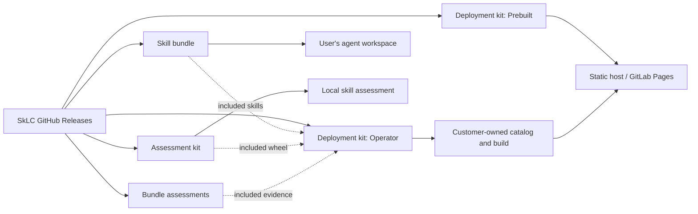
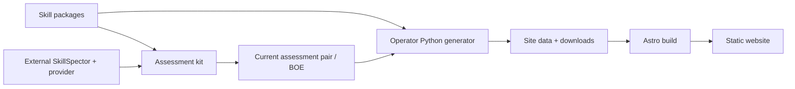

# SkLC architecture

SkLC helps teams use agent skills, assess them, and share them through a static skill exchange. This repository develops and packages independently usable products. A team can install skills, assess its own skills, or host an exchange, depending on what it needs.

Start here for the product relationships and delivery flow. For ownership rules, source layout, permitted dependencies, and independence checks, use the normative [product-boundary contract](product-boundaries.md).

## Products and independent use

| Product | What a consumer gets | Independent use |
| --- | --- | --- |
| Skill bundle | Complete skill packages | Install skills in an AI agent's workspace. Assessment and hosting are optional. |
| Assessment kit | An installable Python CLI | Assess any local skill package and read its results, using an external SkillSpector installation and a configured provider for LLM-assisted assessment. |
| Deployment kit: Prebuilt | A finished exchange website and deployment instructions | Host the supplied site with a static host, including GitLab Pages. The consumer needs no assessment or site-build toolchain. |
| Deployment kit: Operator | Site source, build runtime, assessment wheel, reference CI, and included upstream skills and evidence | Build and host an exchange for the operator's own catalog, with any selected upstream skills. |

Prebuilt and Operator are two modes of the deployment product. The separate skill-bundle-assessments download supplies matching evidence for the upstream skills; it is a companion to the bundle. Skill lifecycle guidance is a parallel product track with a separate publication origin; see the [product requirements](decisions.md#3-products) and [maintainer environment](decisions.md#2-maintainer-environment).

Solid arrows show delivery and use; dotted arrows show components bundled into Operator. The branches are consumer choices. Independent use means each download's documented workflow runs with its included components and declared prerequisites, outside this checkout. Operator composes other products: it bundles the assessment wheel and upstream skills with matching evidence. Operators explicitly select which upstream content to copy into their live catalog alongside their own skills.

## How skills become an exchange

Assessment produces evidence about a skill. Site generation consumes that evidence with the exact skill content it describes. The same Operator generator and site build serve both upstream Prebuilt assembly and a customer's Operator instance.

The skill bundle supplies reusable skills; an operator can also supply entirely its own. The assessment kit owns assessment and report interpretation. Operator owns catalog generation and website presentation. The website serves instructions, assessment context, and downloads as static files.

Generation verifies that each assessment matches its skill and leaves evidence unchanged. Scanner and provider requests happen during assessment; visitors use the built website without invoking them. See the [assessment guide](../products/assessment-kit/README.md) for report meaning and prerequisites, the [Operator runtime](../products/deployment-kit/operator/README.md) for generation behavior, and [governance](../GOVERNANCE.md) for human review and approval responsibilities.

## Maintainer delivery and customer operation

Maintainers develop the products together in this GitHub repository. Upstream CI validates them and builds preview downloads; the release workflow assembles the consumer downloads under one release version. `maintainer/` owns this assembly. Product source and release contents differ because a kit includes the components needed for its consumer workflow. See [CI](../CI.md) for artifact contents, workflow behavior, and the release process.

Customers take those downloads into their own environment. A Prebuilt customer deploys the finished website. An Operator customer owns the live catalog and evidence, then runs the included assessment, generation, build, and deployment flow. Customer GitLab CI operates on that installed kit independently of upstream GitHub workflows. Visitors reach the resulting static site in either case.

For installation or deployment, follow the [Prebuilt guides](../products/deployment-kit/prebuilt/docs/README.md) or [Operator guide](../products/deployment-kit/operator/docs/README.md). For direct skill installation, use the [bundle guide](../products/skill-bundle/README.md). For source changes and local checks, use [Contributing](../CONTRIBUTING.md).
