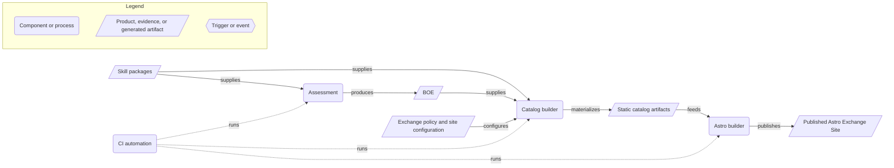
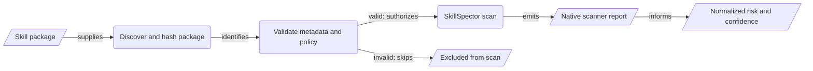
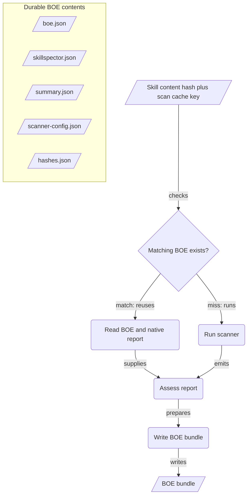
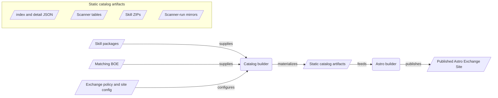
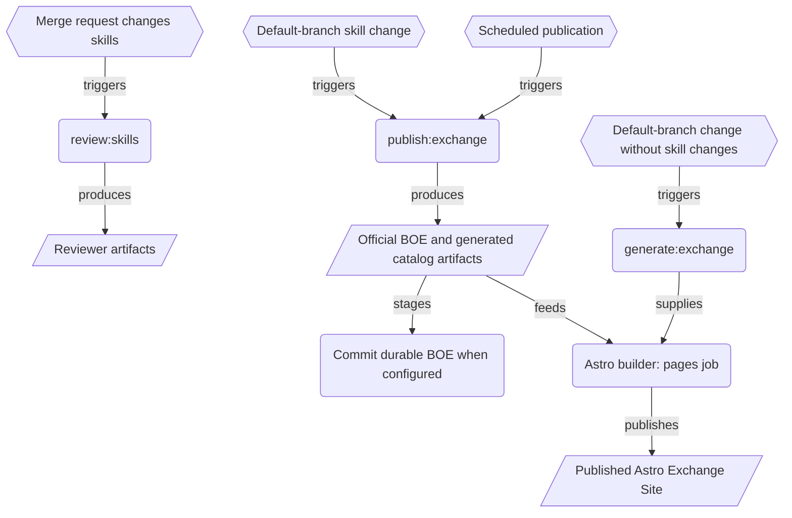
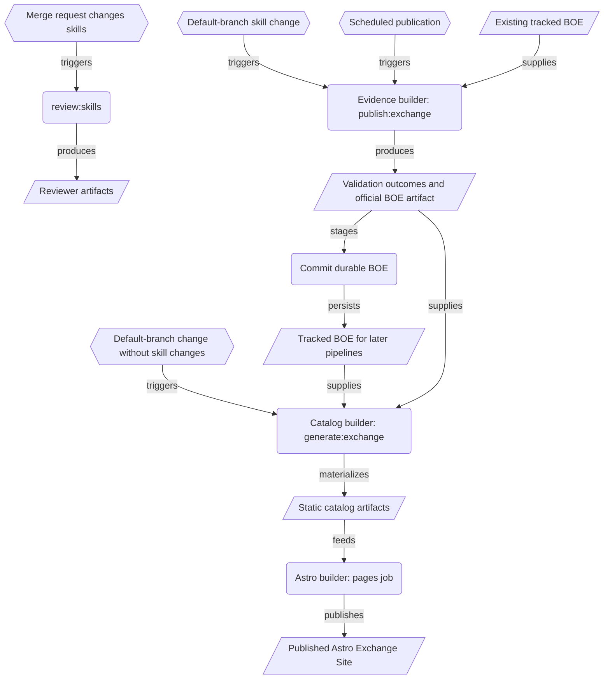

# Static Skill Exchange Architecture

## Purpose

This document describes the current static skill-exchange MVP. It distinguishes assessment and durable evidence from the site-specific artifacts that are materialized for GitLab Pages.

## 1. Component Overview

Assessment produces BOE from skill packages. Skill packages and BOE independently feed the catalog builder, which produces static catalog artifacts. The Astro builder bakes those artifacts into the published Astro Exchange Site.

## 2. Assessment Internals

This layer includes package discovery, content hashing, validation, SkillSpector invocation, and the exchange risk mapping. Merge-request review uses the same core assessment inputs, but produces reviewer context rather than official evidence.

## 3. Evidence Creation and Reuse

The BOE bundle is the durable scanner artifact and evidence bundle. Its matching key lets later publication reuse the recorded scanner evidence and recreate downstream disposable output/artifacts without calling the scanner again.

| File | Purpose |
|---|---|
| `boe.json` | BOE identity, provenance, scan key, selected risk result, and references to companion files. |
| `skillspector.json` | Native SkillSpector report preserved as the primary scanner evidence. |
| `summary.json` | Compact normalized risk, reason, and confidence summary used by downstream consumers. |
| `scanner-config.json` | Effective scanner and LLM configuration used for this scan. |
| `hashes.json` | SHA-256 integrity hashes for the other BOE files. |

## 4. Catalog Builder and Astro Site Build

The index, tables, detail records, ZIPs, and scanner-run mirrors are static projections for the present site. They are not durable evidence and are not committed.

## 5. CI Orchestration Paths

Merge-request assessment is advisory and does not publish official BOE or deploy the Astro Exchange Site. Official publication happens on scheduled pipelines or default-branch skill changes; the Astro builder consumes static catalog artifacts from the publication or generation job.

### Current combined implementation and separation boundary

Both `publish:exchange` and `generate:exchange` invoke the same `build_exchange()` routine. It validates skill metadata, reuses or creates BOE, and materializes static catalog artifacts in one combined orchestration path. `publish:exchange` runs for scheduled publication and skill changes, and may commit durable BOE; `generate:exchange` runs for other default-branch changes and does not commit BOE. If it also committed BOE, each bot-created default-branch commit could trigger another generation job and another bot commit, creating an infinite CI loop.

The underlying functions are already largely separable. A future refactor could use an evidence builder that accepts skill packages, policy, and scan configuration and produces validation outcomes plus BOE bundles; a catalog builder that accepts skill packages, BOE bundles, and site policy and produces indexes, details, tables, ZIPs, and scanner-run projections; and the existing Astro builder that turns those static artifacts into the published site. The significant CI concern is passing newly created BOE to the catalog builder in the same pipeline as a job artifact, rather than waiting for the bot commit to be present in a later checkout. This operational constraint explains the current coupling: one job can create or reuse BOE and immediately materialize catalog artifacts in its own workspace, avoiding a job-to-bot-commit-to-fresh-checkout orchestration sequence. The tradeoff of a split same-pipeline handoff is that publication would build from a transient job artifact rather than source-controlled BOE; it assumes the BOE is committed successfully and that the committed BOE exactly matches the evidence used to materialize the catalog.

