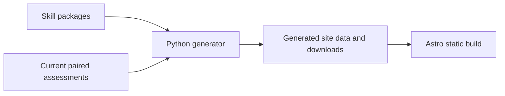

# Static Skill Exchange Architecture

The normative [product-boundary contract](product-boundaries.md) defines ownership,
source layout, permitted composition, and consumer-independence expectations for
architecture changes.

The site builds from skill packages and current adjudicated assessments.

The builder discovers `products/skill-catalog/<skill-id>/`, validates names and descriptions,
and reads `products/skill-catalog-assessments/<skill-name>/`. Each directory contains the unchanged native `skillspector.json`,
paired `adjudication.json`. These two files form the BOE; scanner logs are
diagnostic output for local runs and CI artifacts. The shared public assessment hash
must match `adjudication.skill_sha256`. Git owns history; generation selects no
historical report and runs no scanner or provider.

Native execution must be usable and adjudication completed. Every finding must
pair by its one-based position and rule identity. Nonfatal partial native coverage,
uncertain findings, and negative safety judgments remain advisory. Generated
records contain skill identity, description, full instructions, package files,
catalog metadata, adjudication, and native display
rows. The site summary shows the exact adjudication text, status, coverage judgment,
disposition counts, and limitations; the existing native scanner display remains
evidence separate from safety guidance. The assessment product owns eligibility
and hashing. Reports are copied byte for byte and remain separate downloads.

`--evidence` selects another current-report root; `--generated` selects
derived output. `just generate` writes to `.exchange/local-generated/`. Operator
generation uses the same reader and freshness rule with its preceding job's
reports. Intentional static-only CLI scans retain diagnostics but do not supply
completed adjudication for a site build.

## Builds and downloads

Python produces site data; Astro consumes it. The CI and release workflows use the same evidence-reading path. The prebuilt deployment package contains the resulting site, deployment instructions, and a GitLab Pages job. Each product is one ZIP. Consumers compare its SHA-256 with GitHub’s digest, unzip once, and use it. CI uploads staged directories so its downloads have the same layout.

The skill-catalog download separately packages committed skill files and an installation README. It does not require site generation or assessment.

See [CI](../CI.md) for build and release details.
