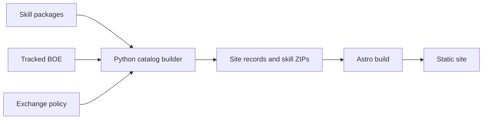

# Static Skill Exchange Architecture

The current site builds from skill packages, exchange policy, and previously generated BOE. Future product boundaries and capabilities are described in the [roadmap](roadmap.md).

## Evidence and catalog generation

The builder discovers skills under `skills/<namespace>/<skill-id>/`, validates exchange metadata, and selects a successful BOE for the exact current content and requested scan mode. It verifies companion hashes, scanner identity and configuration, report completeness, and agreement between the report and recorded risk summary. Missing or invalid evidence fails generation.

Existing BOE bundles use `skill-exchange-boe/v0` and contain:

- `boe.json`: skill identity, provenance, scan key, and recorded risk.
- `skillspector.json`: the native scanner report.
- `summary.json`: risk, reason, and confidence flags.
- `scanner-config.json`: recorded scanner configuration.
- `hashes.json`: integrity hashes for the other four files.

The builder reads these bundles without modifying them. It has no scanner dependency and does not create new evidence. Its index, detail records, tables, scanner-run downloads, and ZIPs are disposable projections for the site.

`publish-local` reads `.exchange/generated/boe/` by default. `--boe-dir` selects another evidence directory; `--generated-dir` selects the derived output directory. `just generate` writes derived output to `.exchange/local-generated/`.

## Builds and downloads

Python produces site data; Astro consumes it. The CI and release workflows use the same evidence-reading path. The prebuilt deployment package contains the resulting site, deployment instructions, and a GitLab Pages job. Each product is one ZIP. Consumers compare its SHA-256 with GitHub’s digest, unzip once, and use it. CI uploads staged directories so its downloads have the same layout.

The skill-catalog download separately packages committed skill files and an installation README. It does not require site generation or assessment.

See [CI](../CI.md) for build and release details.
