# Before and after for SkLC PR #132

These 31 comparisons show the documentation reviewed in [PR #132](https://github.com/Code-dot-mil/SkLC/pull/132) across 11 files. Comparisons 1–29 show the [PR base](https://github.com/Code-dot-mil/SkLC/commit/326531668a43e167ad3382ea73d281e71a389bd6) and the [first reviewed revision](https://github.com/Code-dot-mil/SkLC/commit/7c63f7f1924c05a1909a2e415bd8f38c407a35b4). [Comparisons 30 and 31](#follow-up-corrections) show the two subsequent wording fixes. The images use committed Markdown and locally rendered diagrams. Comparison 5 records the original row 4 download paragraph for reference.

## Project README

[Before](https://github.com/Code-dot-mil/SkLC/blob/326531668a43e167ad3382ea73d281e71a389bd6/README.md) · [After](https://github.com/Code-dot-mil/SkLC/blob/7c63f7f1924c05a1909a2e415bd8f38c407a35b4/README.md)

**1. Project introduction.** The opening spells out Skill Lifecycle, describes its tools, and introduces the Skill Exchange.

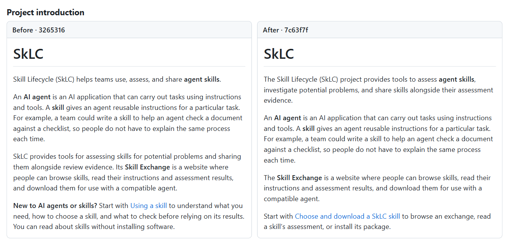

**2. Exchange diagram.** The original diagram showed the five lifecycle stages. Its replacement shows an operator adding existing skills, assessing them, reviewing the results, and sharing them with their evidence.

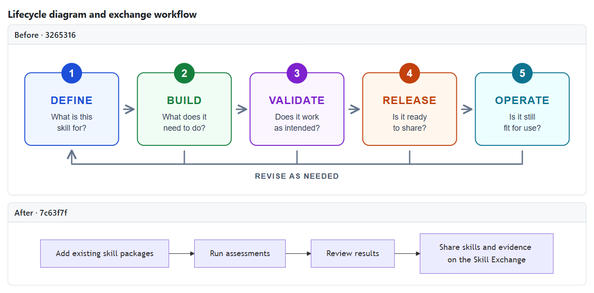

**3. Lifecycle guidance.** The README describes where the tools support validation and release. It points readers to AI4SDLC for guidance on using agents and reviewing their work.

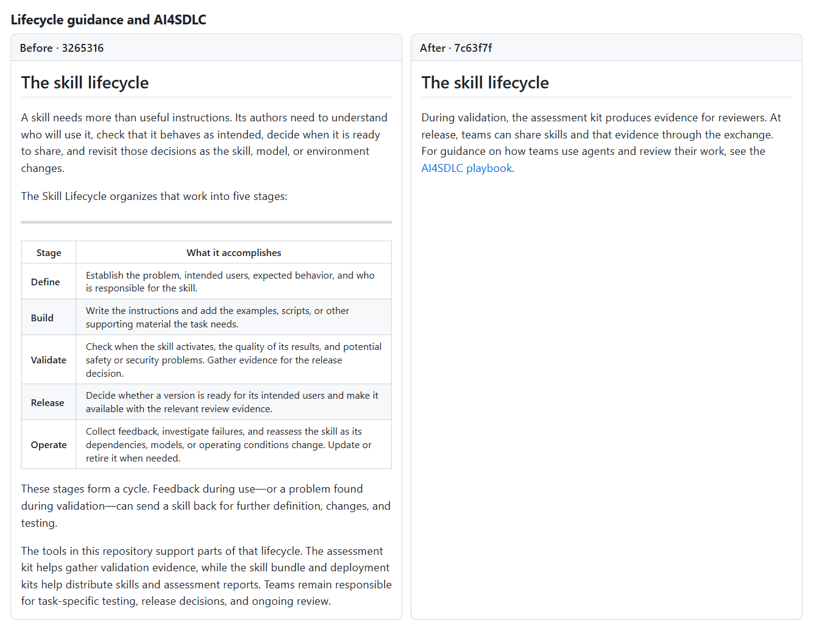

**4. Choosing a download.** The starting-point table drops the fixed skill count. Readers can follow the Architecture link for the relationship between downloads.

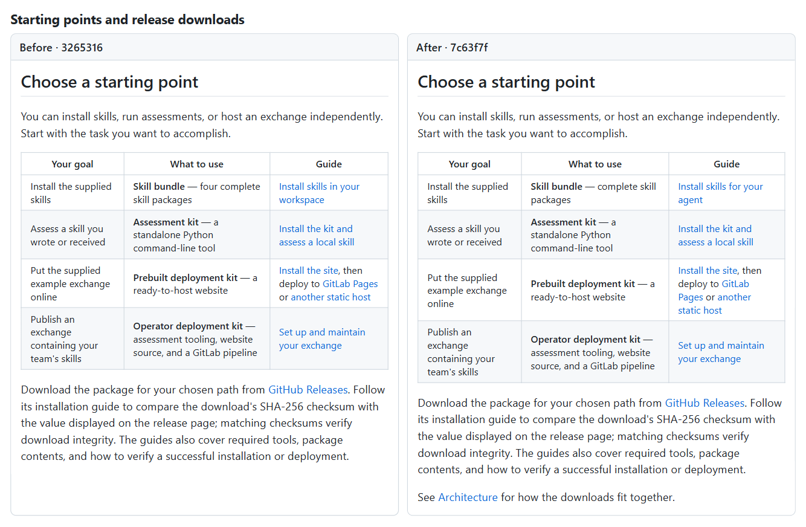

**5. Workbook row 4.** The release-download paragraph is identical in both revisions. The response on this row concerned the skill list, which is addressed in the next comparison.

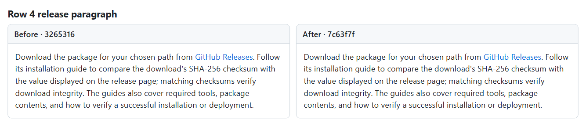

**6. Using the skill bundle.** The overview directs readers to the bundle guide for the current list and installation steps.

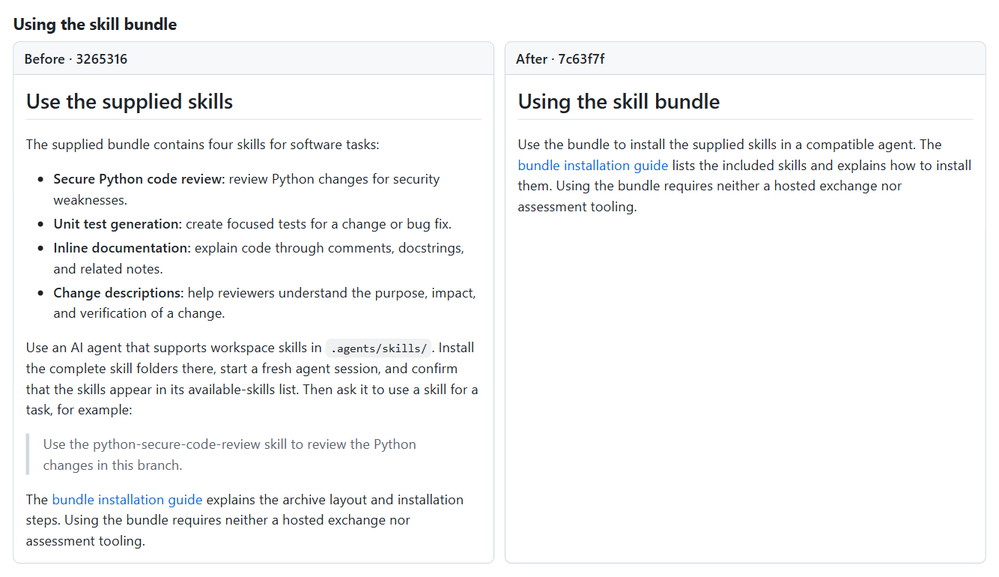

**7. Using the assessment kit.** The new wording identifies what goes to the scanner and what goes to adjudication. It describes dismissed alerts as findings judged to be false positives.

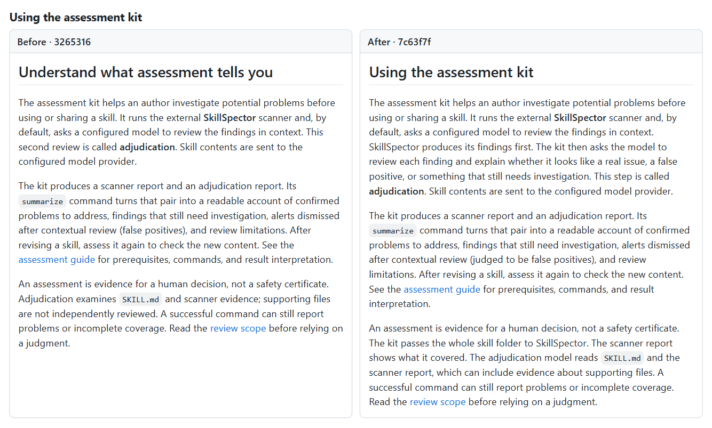

**8. Sharing and contributing.** The exchange section points readers to Governance for approval responsibilities. The contribution link describes the work its guide covers.

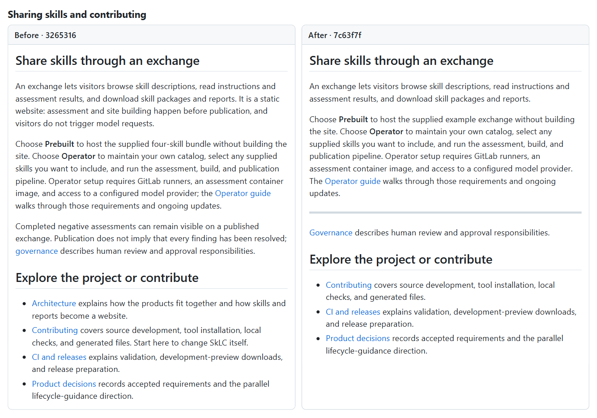

## Reader profiles

[Before](https://github.com/Code-dot-mil/SkLC/blob/326531668a43e167ad3382ea73d281e71a389bd6/docs/PERSONAS.md) · [After](https://github.com/Code-dot-mil/SkLC/blob/7c63f7f1924c05a1909a2e415bd8f38c407a35b4/docs/PERSONAS.md)

**9. Beginner reading path.** The link label uses the beginner guide’s new title.

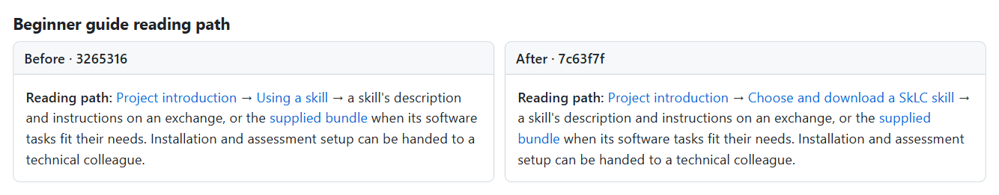

## Beginner guide

[Before](https://github.com/Code-dot-mil/SkLC/blob/326531668a43e167ad3382ea73d281e71a389bd6/docs/using-skills.md) · [After](https://github.com/Code-dot-mil/SkLC/blob/7c63f7f1924c05a1909a2e415bd8f38c407a35b4/docs/using-skills.md)

**10. Agent and skill definitions.** The guide introduces the agent first and illustrates a skill with a unit-test example.

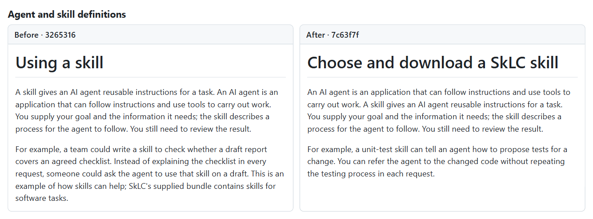

**11. Prerequisites and task fit.** The prerequisites come before browsing. Task fit remains the first checklist question, followed by agent compatibility, other requirements, and information handling.

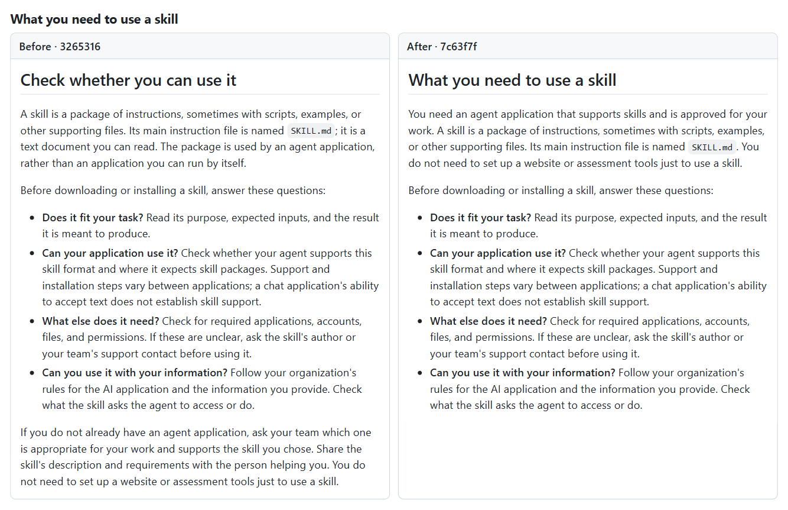

**12. Finding skills.** Readers can browse before installing software. The guide explains where an organization’s exchange fits.

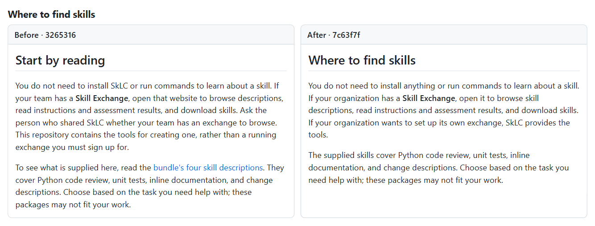

**13. Reading an assessment.** Readers can open Assessment Evidence or follow the guide for downloaded reports. The passage discussed in deferred row 32 retains its original wording.

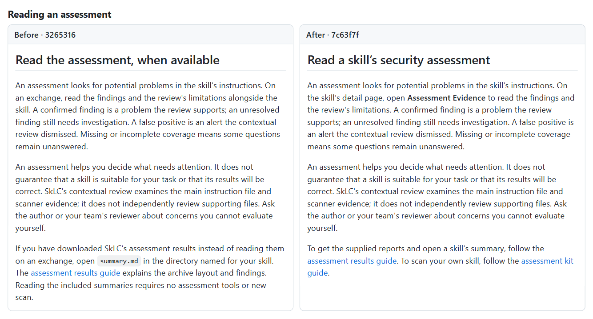

**14. Installing and trying a skill.** The exchange download step leads to installation. The guide includes the agreed unit-test prompt and explains how a team can version a complete skill folder with its project.

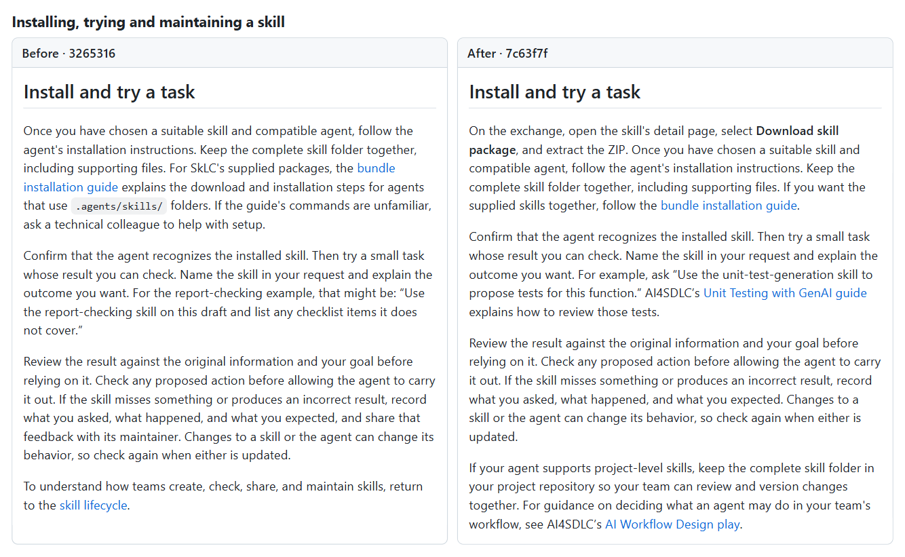

## Skill bundle

[Before](https://github.com/Code-dot-mil/SkLC/blob/326531668a43e167ad3382ea73d281e71a389bd6/products/skill-bundle/README.md) · [After](https://github.com/Code-dot-mil/SkLC/blob/7c63f7f1924c05a1909a2e415bd8f38c407a35b4/products/skill-bundle/README.md)

**15. Agent prerequisites.** Readers check their agent’s documented installation location. The guide retains the command-line prerequisite.

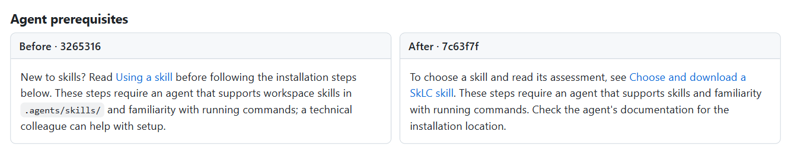

**16. Verifying and extracting the skill bundle.** The guide gives labeled checksum and extraction commands for the reader’s operating system.

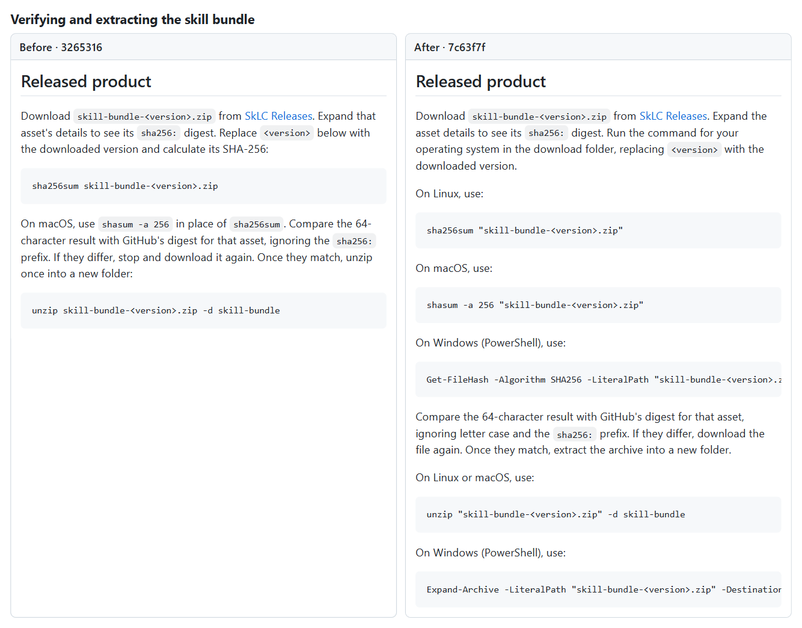

**17. Installing skills and finding their reports.** The project path is an example of a supported install location. The fresh-session instruction is retained, and the reports walkthrough becomes a link to the results guide.

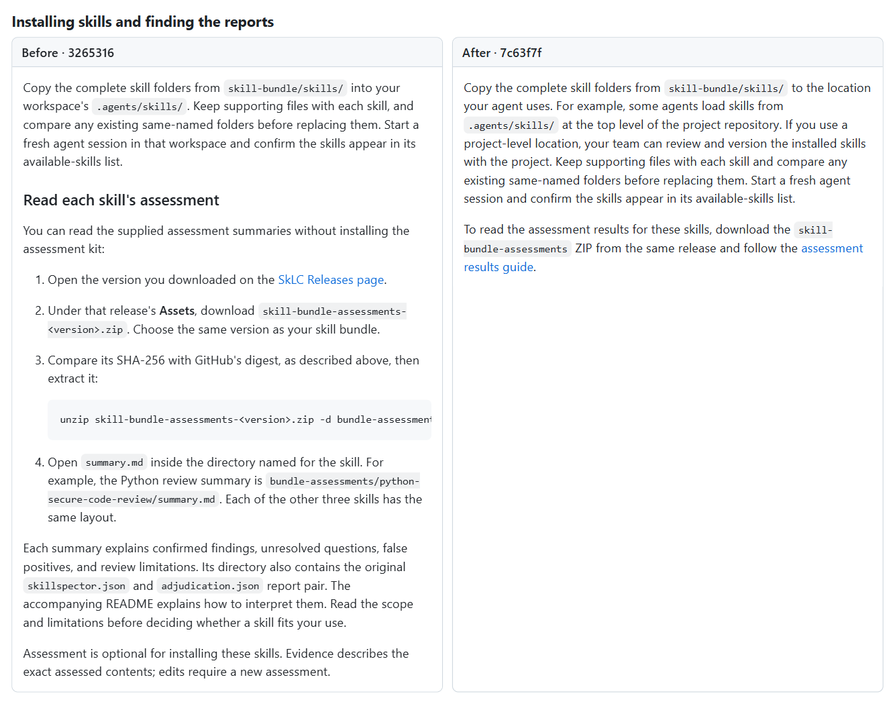

**18. CI artifact walkthrough.** The release bundle guide drops the development-preview section.

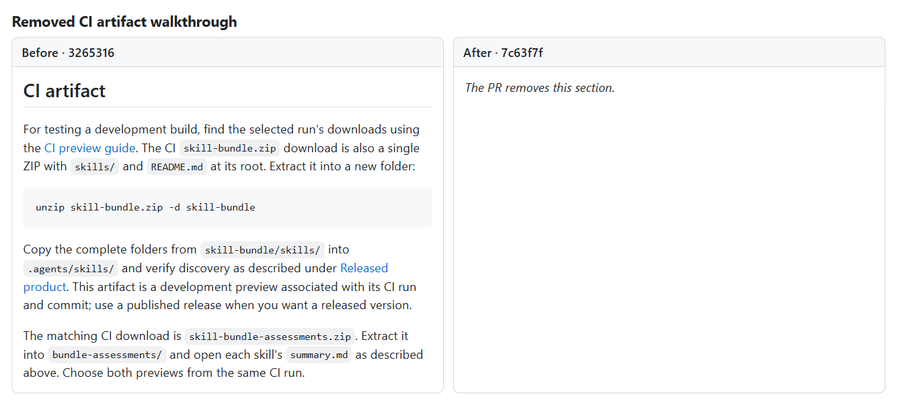

## Assessment kit

[Before](https://github.com/Code-dot-mil/SkLC/blob/326531668a43e167ad3382ea73d281e71a389bd6/products/assessment-kit/README.md) · [After](https://github.com/Code-dot-mil/SkLC/blob/7c63f7f1924c05a1909a2e415bd8f38c407a35b4/products/assessment-kit/README.md)

**19. Assessment kit audience.** The introduction removes the assumption that a colleague is available to help with setup.

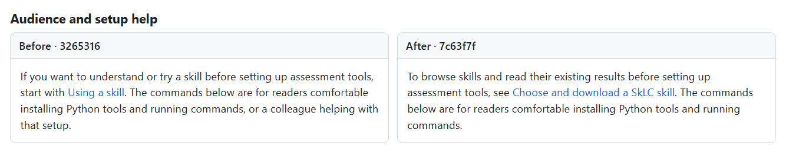

**20. Assessment scope.** The two original scope paragraphs are reordered so the reader encounters the scan before adjudication.

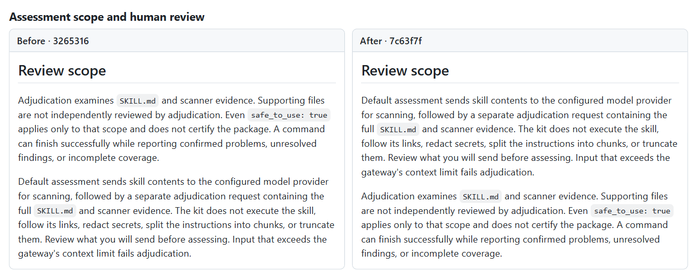

**21. Scanner prerequisites.** The guide states when SkillSpector is needed and removes the aside about wheel installation.

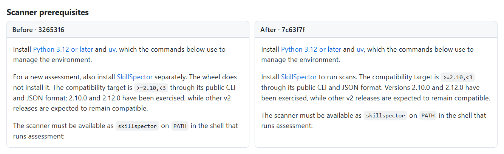

**22. Verifying the wheel.** Linux, macOS, and Windows each have a labeled checksum example using the wheel filename.

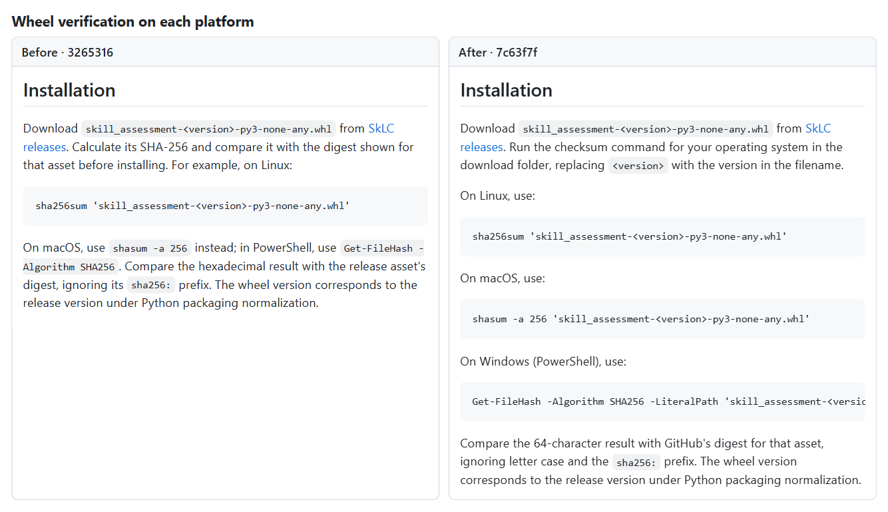

**23. Diagnostic log.** The standalone guide describes the log as diagnostic output and removes the version-control aside.

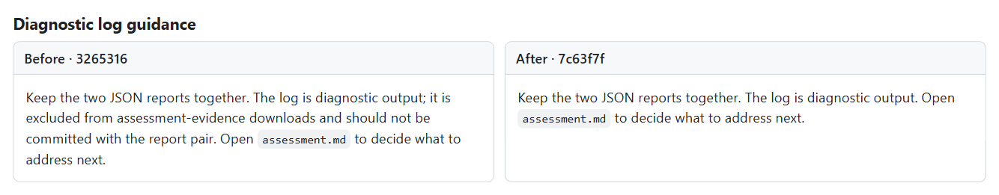

## Assessment reports

[Before](https://github.com/Code-dot-mil/SkLC/blob/326531668a43e167ad3382ea73d281e71a389bd6/products/skill-bundle-assessments/README.md) · [After](https://github.com/Code-dot-mil/SkLC/blob/7c63f7f1924c05a1909a2e415bd8f38c407a35b4/products/skill-bundle-assessments/README.md)

**24. Verifying and extracting the reports ZIP.** Readers get checksum and extraction steps for the reports archive on their operating system.

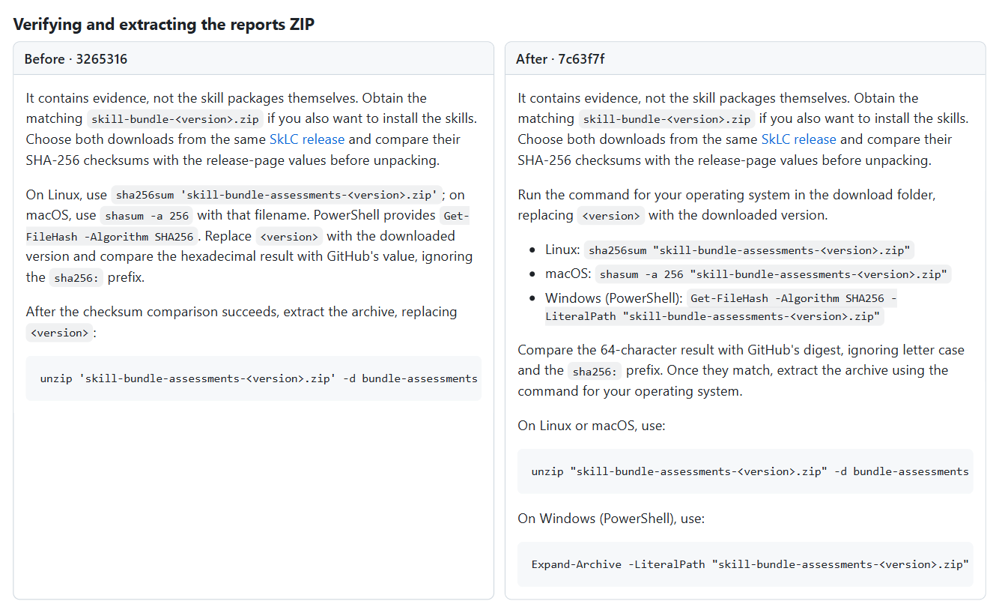

## Prebuilt installation

[Before](https://github.com/Code-dot-mil/SkLC/blob/326531668a43e167ad3382ea73d281e71a389bd6/products/deployment-kit/prebuilt/docs/install.md) · [After](https://github.com/Code-dot-mil/SkLC/blob/7c63f7f1924c05a1909a2e415bd8f38c407a35b4/products/deployment-kit/prebuilt/docs/install.md)

**25. Installing the Prebuilt ZIP.** The guide quotes the versioned filenames and provides both shell and PowerShell extraction steps.

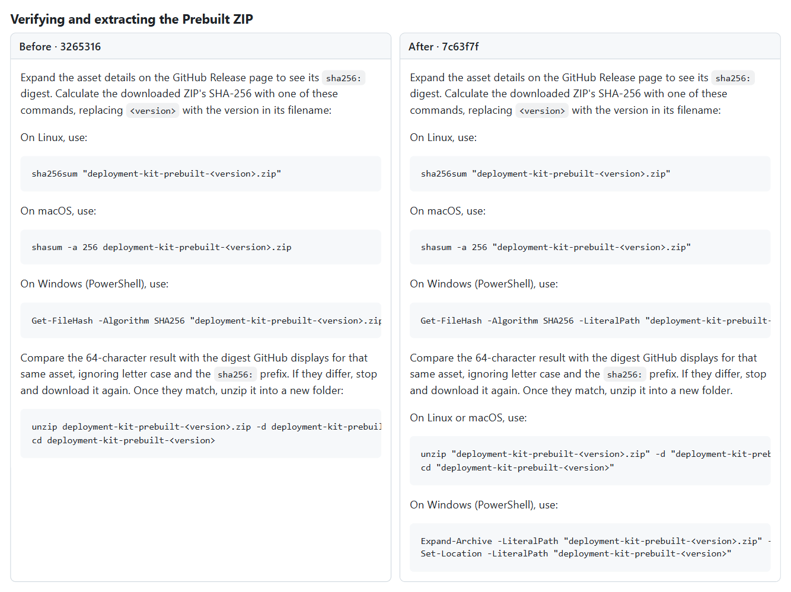

## Operator setup

[Before](https://github.com/Code-dot-mil/SkLC/blob/326531668a43e167ad3382ea73d281e71a389bd6/products/deployment-kit/operator/docs/README.md) · [After](https://github.com/Code-dot-mil/SkLC/blob/7c63f7f1924c05a1909a2e415bd8f38c407a35b4/products/deployment-kit/operator/docs/README.md)

**26. Operator introduction.** The guide moves from the purpose of the Operator kit directly to what the reader will set up.

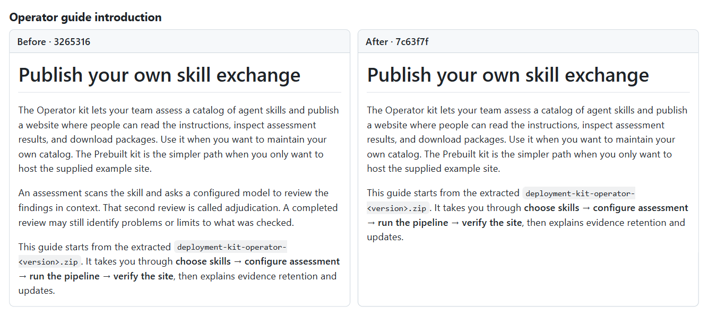

**27. Operator download.** The guide reuses the download-verification steps and identifies the Operator filename and extraction directory to use.

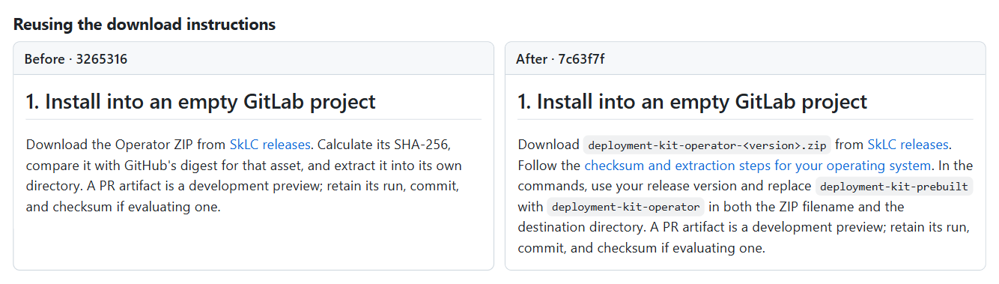

## Governance

[Before](https://github.com/Code-dot-mil/SkLC/blob/326531668a43e167ad3382ea73d281e71a389bd6/GOVERNANCE.md) · [After](https://github.com/Code-dot-mil/SkLC/blob/7c63f7f1924c05a1909a2e415bd8f38c407a35b4/GOVERNANCE.md)

**28. Official bundle approval.** The governance page explains human approval of upstream changes and the current SAFE assessment requirement for official bundle releases.

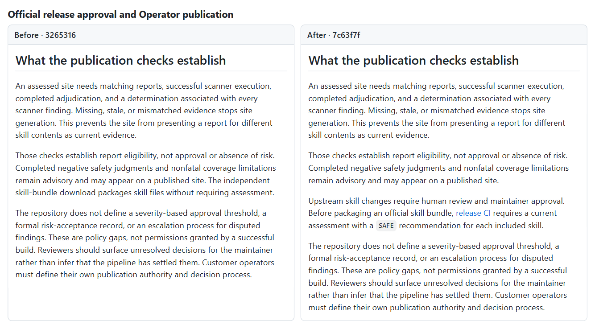

## Architecture

[Before](https://github.com/Code-dot-mil/SkLC/blob/326531668a43e167ad3382ea73d281e71a389bd6/docs/architecture.md) · [After](https://github.com/Code-dot-mil/SkLC/blob/7c63f7f1924c05a1909a2e415bd8f38c407a35b4/docs/architecture.md)

**29. Architecture introduction.** The architecture guide directs readers choosing a download back to the README and keeps its own introduction focused on product relationships.

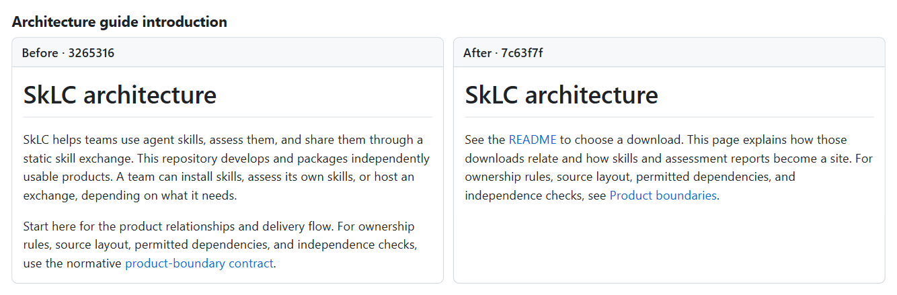

## Follow-up corrections

**30. Installing the CI preview.** The preview download entry now gives the extraction folder and the point at which to resume the packaged installation guide. [Before](https://github.com/Code-dot-mil/SkLC/blob/89ee7b7eb6b6bf3bb44de339045e44b29886bdcd/CI.md#L86) · [After](https://github.com/Code-dot-mil/SkLC/blob/aeccb556539b5b3c92d4d25179afae65b9ed85d1/CI.md#L86)

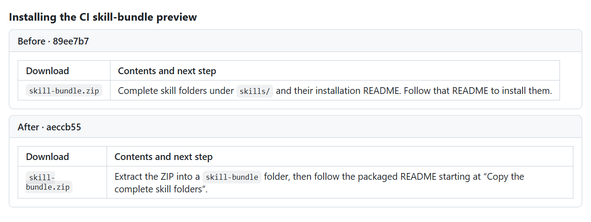

**31. Skill installation location.** The architecture table directs readers to their agent’s documented location, and the diagram labels the result “Installed skills.” [Before](https://github.com/Code-dot-mil/SkLC/blob/89ee7b7eb6b6bf3bb44de339045e44b29886bdcd/docs/architecture.md#L7) · [After](https://github.com/Code-dot-mil/SkLC/blob/aeccb556539b5b3c92d4d25179afae65b9ed85d1/docs/architecture.md#L7)

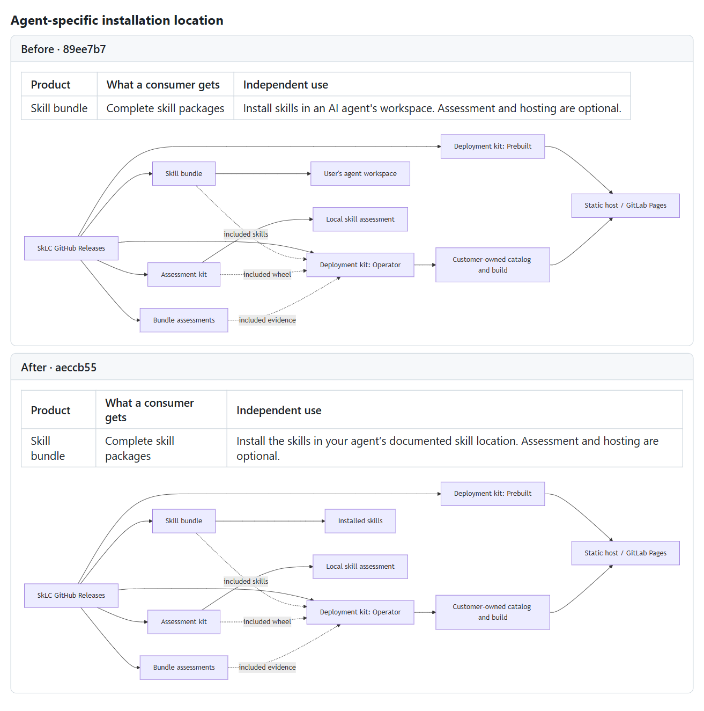
