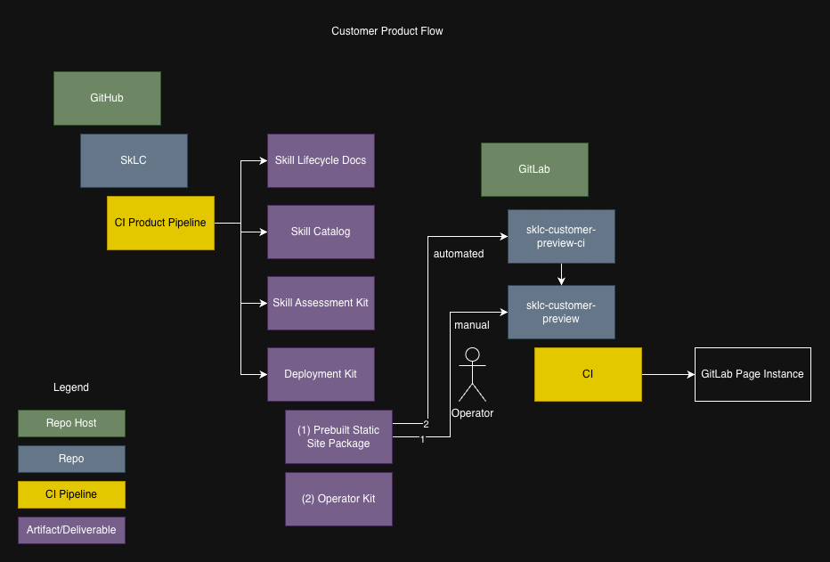
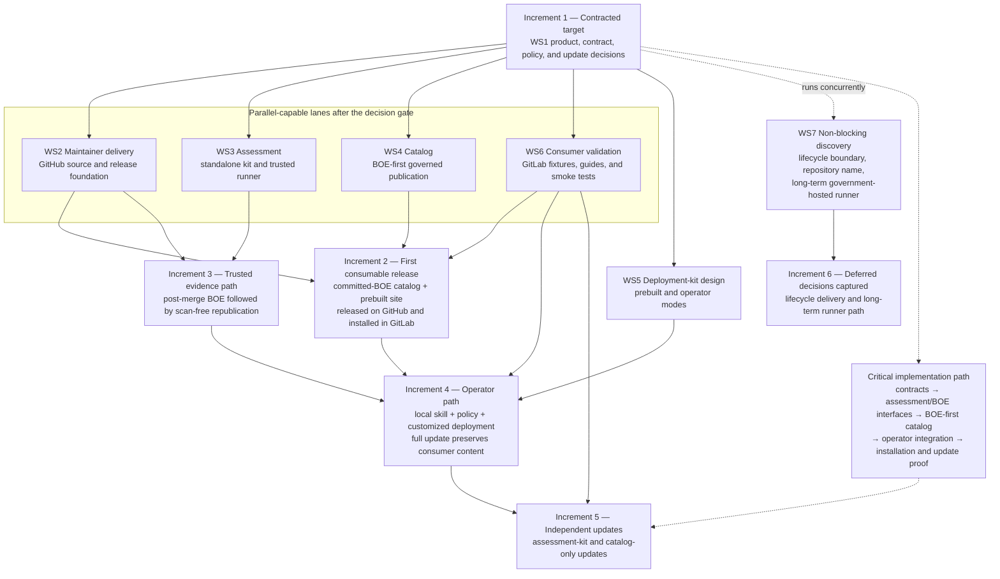

# Q3 2026 Skill Exchange Roadmap

## Objective

Deliver four independently consumable Skill Exchange products from one maintainer repository: skill lifecycle guidance, an assessment kit, a governed skill catalog, and a deployment kit. GitHub is the authoritative source and release system. Consumers install selected versioned releases into their GitLab instance or another supported environment without mirroring the maintainer repository or adopting maintainer release CI.

This roadmap covers Q3 2026. It is a near-term sequence, not a commitment that every target product will be complete by the end of the quarter. **P0** work proves the target product model end to end. **P1** work hardens or expands it. A **decision gate** is a P0 contract decision that dependent implementation must not outrun.

## Supporting goals

1. **Independent products from one source repository.** Co-location in GitHub must not require consumers to install all products or create runtime dependencies between them.
2. **Explicit file and command contracts.** Stabilize the skill-package, assessment-result, BOE, catalog, catalog-policy, release-manifest, CLI, and CI interfaces that join the products.
3. **Trusted assessment.** Establish a temporary MITRE-internal virtual-machine runner for assessment jobs that need LLM access while keeping ordinary build and release work on GitHub-hosted runners.
4. **Complete downstream operation.** Ship supported, tested GitLab CI with the assessment and deployment products rather than expecting a consumer to adapt maintainer workflows.
5. **GitLab installation proof.** Use an internal GitLab repository as a clean consumer environment for released products, full and partial updates, assessment, catalog generation, and deployment.
6. **Simple first gate.** Make current behavior explicit where it is sound, remove accidental coupling, and defer speculative services, framework layers, and compatibility systems.

## Target design summary

The maintainer repository contains product-aligned source roots plus a small neutral `contracts/` area for serialized formats shared across product boundaries. Maintainer GitHub Actions test and release versioned, checksummed artifacts. Each artifact vendors the contract schemas it produces or consumes; no released product imports executable code from `contracts/` or another product's source tree.

The assessment kit turns an arbitrary skill package into verifiable BOE. The governed skill catalog contains served skill packages, matching accepted BOE, and catalog identity metadata. The deployment kit consumes a catalog in one of two ways:

- The **prebuilt static-site package** deploys an already-built exchange without assessment or customization capability.
- The **operator kit** combines released assessment and catalog capabilities with the reference site, build/update tooling, full downstream GitLab CI, and a consumer-owned local overlay.

Lifecycle guidance remains the fourth target product, but its source and packaging boundary with the DoW AI4SDLC GuidanceAsCode repository is a visible, non-blocking decision gate.

```mermaid
flowchart LR
  guidanceRepo[/"GuidanceAsCode repository<br/>source boundary unresolved"/]

  subgraph github["GitHub maintainer repository — source of truth"]
    direction TB
    lifecycleSource[/"Lifecycle source<br/>.skill-lifecycle/ and selected docs/"/]
    contractSource[/"Cross-product schemas and examples<br/>contracts/"/]
    assessmentSource[/"Assessment implementation<br/>products/assessment-kit/"/]
    catalogSource[/"Delivered skills, evidence, and catalog tooling<br/>products/skill-catalog/"/]
    deploymentSource[/"Reference site, installation, update, and CI assets<br/>products/deployment-kit/"/]
  end

  guidanceRepo -. "informs boundary of" .-> lifecycleSource

  subgraph releases["Versioned, independently consumable product releases"]
    direction TB
    lifecycle("1. Skill lifecycle guidance")
    assessment("2. Assessment kit<br/>CLI plus supported assessment CI")
    contracts[["Versioned contracts<br/>skill package · assessment result · BOE<br/>catalog · catalog policy · release manifest"]]
    boe[["Current-schema BOE<br/>for served skill versions"]]
    catalog("3. Skill catalog<br/>skill packages plus accepted BOE")
    catalogManifest[["Catalog manifest<br/>accepted skill and BOE identities"]]
    deployment("4. Deployment kit")

    subgraph modes["Two deployment-kit consumption modes"]
      direction LR
      prebuilt("Prebuilt static-site package<br/>built files plus deployment CI")
      operator("Operator kit<br/>assessment + catalog + reference site<br/>build/deploy CI + local overlay")
    end
  end

  lifecycleSource -->|"packages"| lifecycle
  contractSource -->|"publishes"| contracts
  assessmentSource -->|"builds"| assessment
  catalogSource -->|"builds"| catalog
  deploymentSource -->|"builds"| deployment

  contracts -->|"governs formats for"| assessment
  contracts -->|"governs formats for"| catalog
  contracts -->|"governs inputs to"| deployment
  assessment -->|"creates and verifies"| boe
  boe -->|"qualifies content for"| catalog
  catalog -->|"records accepted entries in"| catalogManifest
  deployment -->|"assembles"| prebuilt
  deployment -->|"assembles"| operator
  catalog -->|"is baked into"| prebuilt
  assessment -->|"supplies capability to"| operator
  catalog -->|"supplies delivered content to"| operator

  subgraph gitlab["Downstream GitLab installation environment"]
    direction TB
    guidanceUse["Author, reviewer, and operator guidance"]
    assessmentOnly["Assessment-only or custom-exchange repository"]
    catalogOnly["Catalog-only or custom-consumer repository"]
    staticInstall["Prebuilt-site installation repository"]
    operatorInstall["Operator installation repository<br/>consumer-owned local/ content"]
    host["GitLab Pages or another static host"]
  end

  lifecycle -->|"guides"| guidanceUse
  assessment -->|"installs into"| assessmentOnly
  catalog -->|"installs into"| catalogOnly
  prebuilt -->|"installs into"| staticInstall
  operator -->|"installs into"| operatorInstall
  staticInstall -->|"publishes"| host
  operatorInstall -->|"publishes"| host

  subgraph legend["Shape legend"]
    direction TB
    legendSource[/Maintainer source area/]
    legendProduct(Released product or kit)
    legendContract[[Versioned contract or durable artifact]]
    legendInstall[Consumer installation or host]
  end
```



*Target product topology. One GitHub maintainer repository publishes four independently consumable products. Versioned file contracts—not shared runtime code—connect products, and downstream GitLab repositories install releases rather than mirror maintainer source.*



*Customer product flow. The CI product pipeline produces the four roadmap products and shows the deployment kit's prebuilt and operator delivery paths to GitLab Pages.*

### Product granularity and primary sources

The current-source column describes where capability exists today; it is not the desired release layout.

| Product | Included capability or content | Primary current source areas | Principal downstream use |
|---|---|---|---|
| Skill lifecycle guidance | Lifecycle method, author and reviewer guidance, and lifecycle metadata or plays | `.skill-lifecycle/`, selected `docs/`, and possibly GuidanceAsCode | Guidance for authors, reviewers, and operators; final packaging is a decision gate. |
| Assessment kit | Skill-package validation, assessor adapters, normalized results, BOE creation and verification, CLI commands, and supported review/CI integration | Assessment-focused modules under `scripts/skill_exchange/`, relevant `.exchange/` schemas or policy, and tests | Standalone assessment or assessment capability installed by the operator kit; no catalog, site, or deployment dependency. |
| Skill catalog | Served skill packages, accepted matching BOE, catalog identity/release metadata, and catalog-admission tooling and contract | `skills/`, `.exchange/generated/boe/`, catalog-focused modules under `scripts/skill_exchange/`, and policy files | A governed collection consumable by the reference site or another catalog consumer. |
| Deployment kit | Catalog materialization, reference Astro site, release/install/update tooling, deployment documentation, and supported operator CI | Deployment-focused modules under `scripts/skill_exchange/`, `site/`, local orchestration, and deployment templates | Prebuilt static-site installation or customizable operator installation. |

### Intended source topology

Product files should move into contiguous roots so release assembly packages product directories instead of cherry-picking mixed files. The exact migration may be incremental, but new public interfaces should follow this ownership model:

```text
contracts/
  skill-package/v1/
  assessment-result/v1/
  boe/v1/
  catalog/v1/
  catalog-policy/v1/
  release-manifest/v1/

products/
  assessment-kit/
    src/
    tests/
    ci/gitlab/
    packaging/
  skill-catalog/
    src/
    content/
    policy/
    tests/
    packaging/
  deployment-kit/
    src/
    site/
    ci/gitlab/
    templates/
    docs/
  lifecycle/
    metadata/
    docs/

maintainer/
  release/
  validation/
```

`contracts/` contains schemas, examples, and explanatory contract documents only. Each contract has a governing product, while its neutral location makes cross-product compatibility reviewable. Products vendor the schemas they need into releases and do not depend on `contracts/` at runtime. Shared executable code does not belong there.

### Contract and ownership model

| Contract or concern | Governing product | First-gate rule |
|---|---|---|
| Skill package | Assessment kit | Validate the package layout and metadata before assessment; catalog tooling may validate against the vendored schema without importing the assessment runtime. |
| Assessment result and normalization | Assessment kit | Normalize native results to `Low`, `Medium`, `High`, or `Unknown`; retain the native report and map native critical results to normalized `High`. |
| BOE | Assessment kit | Create and verify schema, skill identity, content hash, scan key, required files, assessor provenance/configuration, and integrity hashes. |
| Catalog manifest | Skill catalog | Identify exactly which skill content and matching BOE were admitted and served. |
| Catalog-policy schema and evaluation | Skill catalog | Define the portable admission rules for any catalog, independent of a site implementation. |
| Catalog-policy instance | Publisher or operator | Maintainers own the official catalog policy; an operator owns `local/catalog.yaml` for an operator-produced catalog. |
| Presentation and deployment policy | Deployment kit or custom consumer | Control routes, display, sorting, static hosting, and optional further narrowing without changing what an upstream catalog claimed to accept. |
| Release manifest | Each released product | Declare product version, checksums, source revision, produced/consumed contract majors, and composed product versions where applicable. |

The layered catalog-policy ownership avoids tying the catalog to the site: catalog tooling owns admission semantics; a maintainer or operator supplies the policy instance; and any deployment consumes the resulting catalog. A customer building a custom exchange can consume the assessment kit alone for BOE, or add catalog tooling when it wants the governed catalog behavior.

Catalog tooling verifies current matching BOE before applying admission policy; no policy can override invalid evidence. The operator kit ships an explicit `local/catalog.yaml` instead of relying on hidden defaults. An operator may narrow a delivered catalog, but combining delivered and local skills under operator policy creates a distinct operator catalog rather than changing the acceptance claim of the upstream release.

### Assessment-kit public boundary

The independently installable assessment kit exposes CLI and versioned file contracts. Python modules remain implementation details for the first gate.

```text
skill-assessment validate <skill>
skill-assessment assess <skill> --output <boe-directory>
skill-assessment verify-boe <skill> <boe-directory>
skill-assessment review <changed-skills> --output <review-artifacts>
```

The core CLI owns package parsing and validation, assessor invocation, normalized results, native-report preservation, BOE creation and verification, provider-neutral JSON/Markdown review artifacts, and meaningful CI exit statuses. It does not decide catalog admission, generate site/catalog outputs, deploy, commit or push BOE, call GitHub or GitLab APIs, or assemble releases. Shipped CI adds provider behavior around the stable commands.

### BOE compatibility policy

Current catalog releases support only the current BOE major schema. On a breaking BOE-contract update, the latest served version of each skill is reassessed with the latest assessment kit instead of retaining backward-compatible readers.

Legacy BOE remains durable historical evidence; it is not deleted merely because it is no longer served. Catalog materialization selects only the served skill content hash and supported BOE schema, including in derived scanner projections, and does not report an error merely because legacy evidence is present. Warn/error behavior applies only when a currently served skill lacks valid matching BOE in the supported schema. Supporting historical skill versions in a served catalog would be a separate future contract.

## Scope

### P0 scope

- One GitHub maintainer repository and GitHub Actions release system.
- Four target products, with lifecycle packaging retained as an explicit decision gate.
- Standalone assessment-kit and governed-catalog consumption.
- A temporary trusted GitHub Actions runner installed directly on an approved VM.
- Independently downloadable, versioned, checksummed product releases with vendored schemas; the first gate does not require separate release cadences.
- Prebuilt static-site and operator consumption modes of the deployment kit.
- Complete downstream GitLab CI for each supported consumption mode.
- GitLab Pages and generic static-host deployment.
- Local skills, BOE, catalog policy, and safe full or partial product updates.

### Outside the initial gate

- A hosted assessment API.
- Guaranteed compatibility with arbitrary custom UIs.
- Separate source repositories for each product.
- Backward-compatible readers for obsolete major BOE schemas.
- Serving historical versions of skills.
- A speculative policy engine or broad assessor-adapter framework.
- Long-term government compute selection and a second assessor, except for their documented P1 paths.

## Capacity and sequencing

The workstreams do not imply fully staffed implementation lanes. Limit implementation work in progress and integrate slices in dependency order. Assessment extraction and BOE-first catalog work can proceed in parallel after their shared contracts are approved when capacity permits.

## Workstream 1: Product contracts and source-to-release topology

**Priority:** P0 decision gate

### Tasks

1. Approve the four product boundaries and layered policy ownership described above.
2. Establish `contracts/` schemas, examples, READMEs, ownership, and major-version rules for skill package, assessment result, BOE, catalog, and catalog policy.
3. Define release manifests and supported full/partial update compatibility for each product.
4. Treat CLI commands and serialized files as the assessment kit's first public interfaces; keep Python APIs private.
5. Define `local/catalog.yaml` as an explicit operator-owned catalog-admission policy instance evaluated by catalog tooling. It may narrow delivered content and must never admit missing, mismatched, or invalid BOE.
6. Plan and execute the minimum product-aligned file moves. Prevent duplicate source-of-truth files and verify that vendored release schemas exactly match `contracts/`.
7. Decide the lifecycle source/packaging boundary with GuidanceAsCode and defer the repository rename until product terminology is stable.

### Completion criteria

- Every durable artifact, policy semantic, public command, and CI responsibility has an owning product.
- Every promised standalone install or update path declares compatible contract majors and composed product versions.
- Product release assembly can primarily package contiguous product roots without runtime imports across product boundaries.

## Workstream 2: GitHub source and maintainer release foundation

**Priority:** P0

### Tasks

1. Make GitHub the authoritative source and implement GitHub Actions for validation, tests, audits, advisory review, trusted assessment, catalog materialization, site build, product assembly, release publication, and GitHub Pages.
2. Separate maintainer-only artifact assembly and publication workflows from CI delivered to consumers.
3. Produce independently downloadable product artifacts with manifests, checksums, source revision, contract compatibility, catalog identity, and BOE provenance.
4. Route ordinary jobs to GitHub-hosted runners and only trusted assessment to the self-hosted VM runner.
5. Publish the reference GitHub Pages exchange as a maintainer demonstration, not as the downstream installation model.

### Completion criteria

- A protected GitHub revision produces traceable independent product artifacts and the reference site without using internal GitLab as a source mirror.
- Release checks verify artifact contents and vendored contracts at product boundaries.

## Workstream 3: Assessment kit and trusted assessment execution

**Priority:** P0; second assessor and operational hardening are P1

### Tasks

1. Move package discovery, validation, assessor integration, normalization, BOE creation/verification, and review generation behind the standalone CLI and file contracts.
2. Keep delivered skills, catalog tooling, Astro, deployment behavior, BOE commits, and provider API calls outside the core assessment runtime.
3. Preserve advisory merge-request assessment versus trusted post-merge assessment that creates official BOE.
4. Ship complete, tested GitLab CI for validation, merge-request review/comments, trusted assessment, BOE verification, and BOE persistence. The CI calls released commands and implements provider behavior without importing maintainer release workflows.
5. Install the self-hosted GitHub Actions runner directly as a service on the approved temporary VM; define narrow labels, GitHub registration/authentication, Git, Python/UV, SkillSpector, image/package registry, and LLM access. Do not add a Kubernetes or Helm layer.
6. Prove that an independent consumer can assess an arbitrary skill directory and emit BOE without the catalog or deployment kit.
7. **P1:** add a second assessor to validate the adapter/result contract and harden runner operations after the initial path works.

### Completion criteria

- A consumer or trusted workflow installs only the assessment kit and produces integrity-verified BOE accepted by the catalog contract.
- The shipped GitLab CI performs advisory and official assessment flows without maintainer release automation.
- The approved VM executes trusted GitHub assessment jobs and returns non-CUI results and artifacts.

## Workstream 4: Governed skill catalog and BOE-first publication

**Priority:** P0; richer reporting and configuration cleanup are P1

### Tasks

1. Package served skill directories, matching accepted BOE, catalog manifest, policy digest, and release identity as an independently consumable catalog.
2. Separate assessment from catalog materialization. Publication consumes committed BOE and never invokes an assessor.
3. Verify supported BOE schema, skill identity, served content hash, scan key, required files, and every declared integrity hash before admission.
4. Exclude missing, mismatched, or invalid evidence from every downstream output and write a machine-readable exclusion report. Warn/error remains an explicit recovery posture for missing current evidence.
5. Implement catalog policy as a site-independent evaluator. Maintainer and operator policy instances use the same schema; presentation policy remains downstream.
6. Enforce the latest-only BOE policy and filter existing derived scanner data by served content hash and supported schema.
7. Trigger materialization for current BOE, catalog-policy, catalog-tooling, and relevant site-source changes. Pass disposable generated catalog data to the site build as CI artifacts; do not commit it.
8. **P1:** reconcile configuration debt. `.exchange/risk-policy.yaml` is currently unused; normalized risk is hard-coded and not environment-driven. Decide whether to implement/move it as assessment-owned configuration or remove/rename it as contract documentation. Audit and either implement or remove misleading `show_confidence_flags`, `default_sort`, category labels, silent missing-policy behavior, invalid boolean parsing, assessor executable/version mismatch, and duplicated site fallback mappings.

### Completion criteria

- The catalog releases independently and a consumer can verify its exact served skill/BOE pairs.
- The reference site rebuilds from current catalog inputs without scanning.
- Legacy BOE can remain tracked without entering the current catalog or causing false missing-evidence failures.

## Workstream 5: Deployment kit and downstream GitLab CI

**Priority:** P0

### Tasks

1. Define one deployment-kit release with prebuilt and operator consumption modes.
2. Deliver the prebuilt static-site package as the earliest thin slice: final static files, downloads, manifests/checksums, and complete verification/deployment CI for GitLab Pages or a generic static host. It contains no assessment or customization tooling.
3. Deliver the operator kit with released assessment and catalog commands, reference site/build tooling, explicit configuration, and a consumer-owned local overlay for skills, BOE, catalog policy, and supported customizations.
4. Ship a deployment-only `.gitlab-ci.yml` with the prebuilt package. It deploys final static files to GitLab Pages or a generic static host and contains no assessment, catalog-materialization, customization, or maintainer-release behavior.
5. Ship complete, self-contained downstream GitLab CI with the operator kit. It may use bundled local includes and covers validation, tests, audits, merge-request skill review/comments, trusted assessment, BOE verification/persistence, catalog materialization, Astro build, GitLab Pages, and generic static-host artifacts.
6. Define safe updates that verify and stage releases, replace delivered product content, preserve consumer-owned content, and record applied versions.
7. Support assessment-kit-only and catalog-only updates for operators that retain a customized deployment implementation. Do not claim arbitrary site compatibility.

### Operator layout target

```text
app/                    Released commands and build tooling
skills/                 Delivered served skill packages
boe/                    Delivered accepted BOE
site/                   Delivered reference site source
ci/                     Complete supported downstream GitLab CI

local/
  skills/               Consumer-added skill packages
  boe/                  BOE for consumer-added skills
  catalog.yaml          Consumer-owned catalog-admission policy
```

### Deployment-kit source and release layouts

The deployment kit keeps customer documentation and GitLab CI entrypoints separate
for its prebuilt and operator consumption modes. Release assembly maps those source
files into the root-relative locations expected by each downstream GitLab project.

```text
products/deployment-kit/
  docs/
    prebuilt/
      README.md
      install.md
      deploy.md
    operator/
      README.md
      install.md
      deploy.md
      update.md
  ci/gitlab/
    prebuilt/
      .gitlab-ci.yml
    operator/
      .gitlab-ci.yml
```

The prebuilt artifact contains only final static files, downloads,
manifests/checksums, deployment-only CI, and its customer documentation:

```text
README.md
docs/
  install.md
  deploy.md
.gitlab-ci.yml
public/
downloads/
manifest.json
checksums.txt
```

Release assembly maps `docs/prebuilt/README.md` to the artifact-root `README.md`,
the installation and deployment guides to `docs/`, and
`ci/gitlab/prebuilt/.gitlab-ci.yml` to the artifact-root `.gitlab-ci.yml`.

The operator artifact has its own root README, documentation, and CI entrypoint,
along with the complete operator layout above. Release assembly maps the
corresponding `docs/operator/` and `ci/gitlab/operator/` sources into that
artifact. The `local/` subtree remains customer-owned and supported updates must
preserve it.

### Completion criteria

- A consumer can host the unchanged prebuilt release with deployment-only CI.
- An operator can add and assess a skill, apply policy, materialize the catalog, build and deploy Pages, and persist BOE using only released tooling and shipped CI.
- Full and partial updates preserve consumer-owned content according to the documented ownership contract.

## Workstream 6: GitLab installation validation and operator documentation

**Priority:** P0, continuous

### Tasks

1. Create an internal GitLab product-installation repository that begins from downloaded GitHub releases rather than a source mirror.
2. Automate clean, repeatable fixtures for standalone assessment, standalone catalog consumption, prebuilt deployment, operator installation, and full/partial updates.
3. Test checksums, catalog/BOE verification, site/download presence, Pages artifacts, local-content preservation, and assessment-tool absence from the prebuilt package.
4. Write and test prebuilt customer guidance covering artifact installation, explicit configuration and defaults, deployment, and troubleshooting. Write and test separate operator guidance covering runner choices, policy ownership and precedence, assessment paths, deployment, troubleshooting, and updates.
5. Feed installation failures and ambiguous contracts back into release acceptance throughout implementation.

### Completion criteria

- Clean GitLab fixtures install, operate, and update every promised delivery path using only released artifacts and documented configuration.
- The walkthroughs are executable against the supported downstream CI rather than aspirational examples.

## Workstream 7: Lifecycle boundary and future hosting discovery

**Priority:** parallel, non-blocking decision work; subsequent expansion is P1

### Tasks

1. Decide which lifecycle guidance and metadata ship here and which plays live in GuidanceAsCode; define the minimum independently consumable lifecycle deliverable.
2. Decide the repository name and coordinate a single rename with the repository administrator after product naming stabilizes.
3. Investigate government-owned compute, sponsor expectations, infosec requirements, and ODC constraints for the long-term trusted runner without delaying the temporary VM.
4. **P1:** expand lifecycle plays, hosting hardening, and customer-facing lifecycle walkthroughs after initial product paths are proven.

### Completion criteria

- The lifecycle product has a documented source, ownership, linking, and packaging boundary.
- The roadmap records a long-term runner decision path without making it a hidden initial-delivery prerequisite.

## Dependencies and parallel execution

Workstream 1 begins with a short contract pass. Implementation may prototype during that pass but must not establish public interfaces that conflict with the decision gate. Once the assessment/BOE, catalog/policy, release, and update contracts are stable enough, use these capacity-aware lanes:

| Lane | Work | Dependency |
|---|---|---|
| Maintainer delivery | GitHub migration and release foundation | Product artifact and release-manifest outline |
| Assessment | Assessment-kit extraction and temporary runner | Skill, result, and BOE contract majors |
| Catalog | BOE-first split and governed catalog | BOE, catalog, and catalog-policy contract majors; does not wait for runner provisioning |
| Consumer | GitLab fixtures and install-guide drafts | Starts with contract examples; validates every released slice |

Additional sequencing rules:

- Establish stable assessment commands before adapting GitHub Actions; assessment extraction does not wait for the full migration.
- Catalog refactoring uses tracked BOE fixtures and does not wait for the trusted runner.
- Start the prebuilt static-site slice when release assembly and the BOE-only catalog build converge; it does not wait for operator customization or a second assessor.
- Design the operator kit in parallel, but integrate it after assessment, catalog, policy, and update contracts stabilize.
- Run lifecycle and long-term hosting discovery concurrently without consuming the critical path unless explicitly promoted to P0.



*Execution model. Product contracts open four parallel-capable lanes, but available staffing limits implementation work in progress. Releasable slices converge through six integration increments; lifecycle and long-term hosting discovery remain non-blocking.*

## Integration increments and critical path

1. **Contracted target:** approve the product map, contracts, public interfaces, layered policy ownership, release/update manifests, and minimum repository refactor.
2. **First consumable release:** produce a catalog from committed current BOE, assemble the prebuilt site on GitHub, and deploy the released package in the GitLab installation fixture.
3. **Trusted evidence path:** install the standalone assessment kit on the VM runner, create official BOE post-merge, and use the later BOE-triggered workflow to republish without scanning.
4. **Operator path:** install the operator kit in GitLab, add and assess a local skill, apply catalog policy, deploy the customized site, and prove a full update preserves consumer-owned content.
5. **Independent updates:** update only the assessment kit and/or delivered catalog while retaining the operator's deployment implementation and local content.
6. **Deferred decisions captured:** record the minimum lifecycle-guidance delivery and long-term government-hosted runner path.

The critical implementation path is:

```text
product contracts
  -> assessment and BOE interfaces
  -> BOE-first governed catalog
  -> operator-kit integration
  -> automated installation and update proof
```

GitHub release automation, temporary-runner provisioning, early GitLab fixtures, lifecycle-boundary work, and long-term hosting discovery proceed in parallel and join only where an increment consumes their output.
