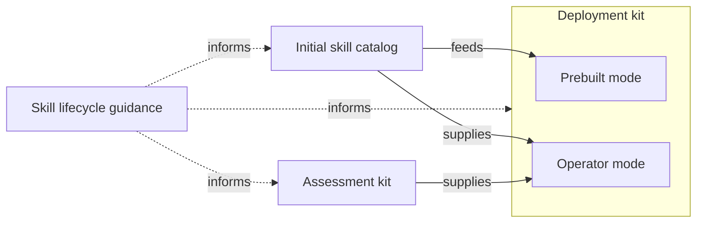

# Skill Exchange Release Roadmap

## 1. Objective

Deliver four standalone products as independently consumable artifacts in cumulative GitHub releases: skill lifecycle guidance, the assessment kit, the initial skill catalog, and the deployment kit. Private GitHub is the source of truth and release origin for the assessment kit, initial skill catalog, and deployment kit. Skill lifecycle guidance will be published from the Code-dot-mil AI4SDLC GitHub after the team accepts the minimum useful guidance shape. Customers receive released artifacts and deploy or use them in GitLab without mirroring maintainer source or importing maintainer release workflows.

The Q3 priority is the smallest release path that proves this model: GitHub publishes a checksummed release, a clean GitLab project receives it, and GitLab Pages deploys it. Work that does not protect product independence or prove GitHub-to-GitLab delivery is deferred.

## 2. Design summary

### 2.1 Products

- **Skill lifecycle guidance:** a parallel guidance and research track that will become a versioned guidance bundle published from the Code-dot-mil AI4SDLC GitHub after the team agrees on the minimum useful lifecycle guidance. It does not gate the assessment kit, initial catalog, or deployment kit.
- **Assessment kit:** standalone CLI with commands and reference CI for validating and assessing skills, producing native assessor output, and maintaining BOE manifests.
- **Initial skill catalog:** complete skill packages for developer installation and skill-exchange use, starting with Secure Code Review, Unit Test Generation, Inline Documentation, and Commit Message and PR Description. Future releases will select the published set through maintainer policy and may offer associated assessment evidence as a separate download.
- **Deployment kit:** provides the reference implementation for the skill exchange site. It has two modes:
  - **Prebuilt:** a ready-to-deploy static site with deployment CI and documentation.
  - **Operator:** site source, build tooling, and reference CI for configuring, building, and deploying a skill exchange from released components.

### 2.2 How the products fit together

Each product has its own release artifact, but products and components are not individually versioned. A SkLC GitHub Release has one version, and every artifact in that release uses that version. Documented file formats and commands allow the products to work together without sharing code. Shared schemas and examples live under `contracts/` where products need a common serialized format; each product defines the formats it needs.

| Product | Release artifact | Uses another product? | Primary use-case |
|---|---|---|---|
| Skill lifecycle guidance | Code-dot-mil AI4SDLC GitHub guidance | No | Help users understand and apply the skill lifecycle. |
| Assessment kit | Python wheel, usage documentation, and optional GitLab CI profile | No | Validate skills, run assessments, and produce BOE. |
| Skill catalog | Complete skill packages and download integrity information | No | Install skills or supply a skill exchange. |
| Deployment kit - prebuilt | `deployment-kit-prebuilt` with deployment-only GitLab CI | Released catalog artifacts and optional assessment-kit artifacts | Deploy GitLab Pages or a static hosted site from released static site artifacts. |
| Deployment kit - operator | `deployment-kit-operator` with reference GitLab CI | Compatible SkLC release artifacts for skill catalog, assessment kit, and assessment artifacts | Build and deploy GitLab Pages or a static hosted site from released catalog and assessment-kit inputs. |



Solid arrows show how released products are used together. Dotted arrows show where lifecycle guidance may later inform the products. The guidance track is parallel and non-gating until its minimum useful shape is accepted. Each product still stands alone.

The source tree follows the same product boundaries:

```text
contracts/
products/
  assessment-kit/
  skill-catalog/
  deployment-kit/
    site/
    prebuilt/
    operator/
  lifecycle/          deferred until the guidance shape is accepted
maintainer/
```

## 3. Release strategy

Each milestone produces a usable release or a documented internal capability. Customer-facing releases are published from GitHub with product-specific integrity checks and installation documentation. Skill lifecycle guidance is published from the Code-dot-mil AI4SDLC GitHub; the assessment kit, initial catalog, and deployment kit are published from the maintainer GitHub release process. Customers consume those releases in GitLab; they do not mirror maintainer source or import maintainer release workflows. The SkLC release process is described in `CI.md` and guided by `.agents/skills/sklc-release-process`.

Some products include reference GitLab CI after their core behavior exists. That CI is customer-facing packaging: it shows how to run the released product in GitLab. It is not a separate product, and it does not reuse maintainer GitHub workflows.

The sequence is release-first. Release-first means each milestone is judged by the released artifact it produces and how that artifact is verified in its target consumption path. Internal work matters only when it is required to publish, install, run, or deploy that artifact. This keeps the roadmap focused on customer delivery instead of source-tree cleanup or maintainer automation. The milestones follow this order:

1. Prove the GitHub-to-GitLab path with the prebuilt reference site.
2. Release the initial catalog, assessment kit, and deployment kit as each meets its milestone acceptance criteria.
3. Keep skill lifecycle guidance as a parallel non-gating milestone until the team accepts a minimum guidance shape.
4. Add customer GitLab CI only where it is needed to run an already released product.
5. Assemble the operator foundation from compatible released catalog and assessment-kit artifacts.
6. Add operator-managed updates after the install, build, and deploy path works.

Q3 must ship:

1. A GitHub release process that publishes manifests and checksums.
2. The prebuilt reference site release installed unchanged in a clean GitLab project and deployed to GitLab Pages.
3. Release scope and acceptance criteria for the initial catalog, assessment kit, and deployment kit, with lifecycle guidance explicitly tracked as parallel non-gating research.

### 3.1 MVP — Prebuilt reference site

#### 3.1.1 Customer outcome

A customer can obtain a prebuilt reference skill-exchange site from GitHub Releases and deploy it unchanged to GitLab Pages.

#### 3.1.2 Scope

Included:

- Final static files and downloads.
- Deployment-only reference GitLab CI.
- Installation and deployment documentation.

Excluded:

- Assessment tooling or execution.
- An independently consumable initial-catalog release or site-build tooling.
- Operator customization and update support.
- Generic static-host validation.

#### 3.1.3 Team delivery tasks

1. Establish GitHub as the source of truth and implement the release process for the prebuilt site.
2. Package the static site, downloads, manifest, checksums, deployment CI, and documentation as one release artifact.
3. Support GitLab Pages without requiring the customer to build the site.
4. Test the installation and deployment instructions in a clean GitLab project.

#### 3.1.4 Acceptance evidence

- A developer obtains the artifact from the GitHub Releases page, verifies its checksums, and deploys it unchanged to GitLab Pages in a clean GitLab project using the shipped documentation and CI.
- The installed release serves the expected site and downloads without assessment or build tooling.

### 3.2 Parallel milestone — Skill lifecycle guidance

#### 3.2.1 Customer outcome

A customer can eventually obtain released lifecycle guidance from the Code-dot-mil AI4SDLC GitHub and use it without installing the catalog, assessment kit, or deployment kit. This milestone is not on the critical path for the Q3 release proof.

#### 3.2.2 Scope

Included:

- Research and decision work to define the minimum useful customer-facing skill lifecycle guidance.
- A simple stage-based framing using the established lifecycle terms: Define, Build, Validate, Release, and Operate.
- A minimal role vocabulary that stays secondary to the stages: user, author, reviewer, and operator.
- Release-stage guidance for recording catalog approval authority without making approval a standing lifecycle role.

Excluded:

- Blocking the assessment kit, initial catalog, prebuilt site, or operator milestones.
- Detailed guidance delivery planning until the guidance shape is accepted.
- A repository rename.
- New workflow engines, wrappers, or generated guidance systems.
- Heavy governance models, research-only lifecycle mechanisms, or mandatory evaluation programs.

#### 3.2.3 Team delivery tasks

1. Record the current guidance direction as a research note in the lifecycle repository.
2. Decide the first customer-facing guidance shape, including how each stage helps someone recognize where a skill is and what to do next.
3. Decide the smallest useful skill record and how catalog approval should be recorded at Release.
4. Plan the first guidance release after those decisions are accepted.

#### 3.2.4 Acceptance evidence

- A dated research note records the current uncertainty, proposed direction, and open questions.
- The roadmap identifies lifecycle guidance as a parallel non-gating milestone.
- The assessment kit, initial catalog, and deployment kit can proceed without depending on lifecycle guidance.

### 3.3 Release milestone — Initial skill catalog

#### 3.3.1 Customer outcome

A customer can obtain the initial skill catalog for use in a GitLab-hosted skill exchange site or for direct distribution to developers.

#### 3.3.2 Scope

- Exactly the four named skill folders and their committed supporting files.
- A short README explaining download, extraction, and workspace installation.
- One archive checksum.

Assessment, BOE packaging, policy-derived selection, and site generation are
outside the initial download milestone.

#### 3.3.3 Team delivery tasks

1. Archive the four folders and README from the selected Git commit.
2. Generate the archive checksum and publish both files through CI and releases.
3. Check the downloaded file set and installation instructions.

#### 3.3.4 Acceptance evidence

- The download contains exactly the four complete skill folders and README.
- Its checksum matches; untracked files and unrelated repository content are absent.
- A developer copies the folders into a clean workspace's `.agents/skills/` and
  confirms a fresh agent session discovers those workspace skills.

#### 3.3.5 Future capabilities

- Select the published skill set through maintainer policy, while distributing complete skill packages.
- Optionally distribute BOE and native reports separately, associated with the exact skill contents they describe.

Evidence packaging and consumer requirements remain to be defined.

### 3.4 Release milestone — Assessment kit foundation

#### 3.4.1 Customer outcome

A customer can install the assessment kit and assess their own skills, retaining native assessor output and BOE manifests.

#### 3.4.2 Scope

Included:

- Four public commands:
  - `validate` checks that skill packages are valid.
  - `advise` produces native assessor reports and author-facing advice. It does not create a BOE or decide publication.
  - `assess` retains supported native assessor reports and updates each skill's BOE manifest with the path and SHA-256 digest of each report.
  - `verify-boe` checks that a BOE matches the selected skill and that each listed report exists and matches its recorded SHA-256 digest.
- One explicitly selected skill per invocation, using SkillSpector for advice and assessment.
- Supported assessor versions and unchanged native assessor output.

Excluded:

- Reference CI and provider integrations.
- Publication decisions or catalog-policy evaluation.
- Catalog assembly, site build, deployment, commits, pushes, or provider API calls in the core assessment runtime.
- A required namespace or fixed repository layout beyond valid skill packages.

#### 3.4.3 Team delivery tasks

Deliver these steps as separate PRs, each with its behavior tests and usage guidance:

1. Installable wheel and validation.
2. Single-skill advice.
3. Assessment evidence.
4. Offline evidence verification.
5. Wheel release integration.

#### 3.4.4 Acceptance evidence

- A developer obtains the assessment-kit artifact from GitHub Releases, verifies its checksums, installs the wheel in an isolated local environment, configures the assessment kit, and runs it against a local skill package without the catalog, site, deployment kit, GitLab project, or GitLab CI.
- The local run produces advice artifacts, native reports, and BOE accepted by the released `verify-boe` command.

#### 3.4.5 Future capabilities

- Assess multiple explicitly selected skills in one invocation.
- Discover skill packages recursively below a selected root.
- Support reusable configuration files, machine-readable advice manifests, and additional assessors as consumer needs are established.

### 3.5 Assessment-kit later release — GitLab CI profile

#### 3.5.1 Customer outcome

A customer can use a supported assessment-kit GitLab CI profile for skill advice and assessment without designing the jobs themselves.

#### 3.5.2 Scope

Included:

- A minimal reference GitLab CI profile with separate advice and assessment jobs. Customers provide the skill directory, output locations, assessor settings, and credentials.
- Advice-job artifacts containing the assessor's original reports and `advice.md`, without a BOE.
- Assessment-job artifacts containing the assessor's original reports and the updated BOE.
- Documentation for manually persisting verified reports and updated BOE.

Excluded:

- Catalog assembly, site build, or deployment.
- Maintainer GitHub Actions.
- Merge-request comments or bot-driven BOE commits.

#### 3.5.3 Team delivery tasks

1. Package the reference GitLab CI as a later assessment-kit release.
2. Test advice and assessment with explicit skill and output locations, customer-provided assessor settings and credentials, and job-artifact retention.
3. Document runner, credential, assessor-access, CI configuration, and manual BOE persistence requirements.

#### 3.5.4 Acceptance evidence

- A developer configures the reference CI in a clean GitLab project using the shipped documentation.
- The advice job retains the documented advice and native reports without producing a BOE.
- The assessment job retains native reports and a BOE accepted by the released `verify-boe` command.
- The assessment job makes no source-control changes.

### 3.6 Deferred internal milestone — Catalog assessment automation

#### 3.6.1 Maintainer outcome

SkLC maintainers use the in-repository assessment kit to advise on proposed skill changes and maintain assessment records for the initial catalog.

This milestone is not part of the Q3 MVP unless BOE is required for an accepted catalog release.

#### 3.6.2 Scope

Included:

- GitHub Actions that set up and invoke the assessment kit from the current checkout.
- Advice for proposed skill changes before merge.
- Assessment after skill changes reach `main`.
- An approved maintainer runner for jobs that require assessor access.
- Source-controlled native assessor reports and BOE manifests for the initial catalog.

Excluded:

- Automated publication decisions or catalog-policy changes.
- Customer GitLab CI or operator deployment.
- Repository-private assessment interfaces.

#### 3.6.3 Team delivery tasks

1. Install and secure the maintainer assessment runner with the required assessor access.
2. Adapt maintainer GitHub Actions to set up and invoke the assessment kit from the current checkout.
3. Run advice for proposed skill changes and assessment after skill changes reach `main`.
4. Store verified native reports and updated BOE manifests in the source-controlled initial catalog.
5. Keep jobs that do not require assessor access on GitHub-hosted runners.

#### 3.6.4 Acceptance evidence

- Maintainer advice and assessment workflows set up and use the assessment kit from the current checkout.
- Advice on a proposed skill change does not create a BOE or alter catalog policy.
- Assessment after a skill change reaches `main` stores native reports and an updated BOE in the initial catalog, and the checked-out `verify-boe` command accepts them.

### 3.7 Release milestone — Operator foundation

#### 3.7.1 Customer outcome

An operator can install released components in their GitLab environment, configure and run the reference pipeline, and build and deploy a skill exchange.

#### 3.7.2 Scope

Included:

- Compatible released catalog and assessment-kit artifacts. The initial catalog is used as the reference test input, not as a structural dependency.
- Reference site source and build tooling.
- Reference GitLab CI that reuses the assessment CI profile and adds site build and deployment. BOE persistence uses job artifacts and documented manual source-control steps unless later automation is justified by demonstrated customer need.
- Operator installation, configuration, and troubleshooting documentation.

Excluded:

- An operator-owned local overlay.
- Preservation of operator changes across product updates.

#### 3.7.3 Team delivery tasks

1. Assemble the operator release from compatible released catalog and assessment-kit artifacts plus the deployment kit's site and operator assets.
2. Reuse the released assessment CI profile and add site-build and deployment jobs.
3. Document runner, credential, assessor-access, catalog input validation, build, and deployment requirements.
4. Install the release in a clean GitLab project, resolve in-scope gaps, and document supported environment constraints or deferred needs.

#### 3.7.4 Acceptance evidence

- A developer obtains the operator release from GitHub Releases and installs it in a clean GitLab project using the shipped documentation.
- The reference pipeline runs advice and formal assessment for the installed catalog's skills, verifies BOE, retains BOE as artifacts, builds the site, and produces a GitLab Pages artifact.
- The operator pipeline makes no source-control changes by default.
- Every required customer-provided runner, credential, and configuration value is documented.

### 3.8 Post-Q3 milestone — Operator-managed updates

#### 3.8.1 Customer outcome

An operator can add locally owned skills, BOE, and catalog policy, then apply a supported full product update without modifying that local content.

#### 3.8.2 Scope

Included:

- An operator-owned `local/` overlay for skills, BOE, and catalog policy.
- Explicit precedence between released catalog content and the operator-owned overlay.
- Verified and staged full operator-release updates.
- Applied-version records plus update and recovery documentation.

```text
catalog/                Compatible released catalog content
site/                   Released site source and build tooling
wheels/                 Released assessment kit and dependencies
ci/                     Reference GitLab CI
docs/

local/                  Operator-owned; updates preserve this subtree
  skills/
  boe/
  catalog-policy.yaml
```

Excluded:

- Compatibility guarantees for arbitrary custom sites or deployment implementations.
- Offline or air-gapped operation.
- Historical skill serving or compatibility with obsolete assessor-output formats.
- Assessment-kit-only partial updates until full update proof is accepted and demonstrated customer need justifies the added support.

#### 3.8.3 Team delivery tasks

1. Define and document the ownership boundary between released content and the `local/` subtree.
2. Implement update staging, integrity verification, product replacement, local-content preservation, and applied-version recording.
3. Support full updates and catalog-only updates. Define assessment-kit-only updates only after full update proof is accepted and demonstrated customer need justifies the added support.
4. Document update, recovery, and operator-ownership procedures.
5. Test each supported update path in a clean GitLab project containing operator-owned skills, BOE, and policy.

#### 3.8.4 Acceptance evidence

- Full updates leave the operator-owned `local/` subtree unchanged.
- A catalog-only update can be applied without disturbing local overlays or released components outside the catalog.
- An operator can update the delivered products while retaining the local overlay.
- A failed verification leaves the installed release and local content unchanged.
