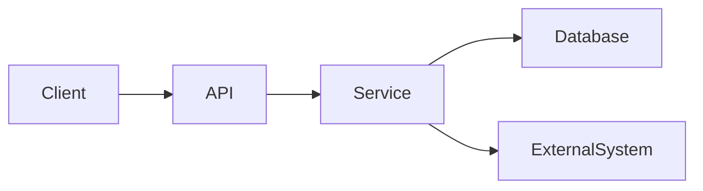

# Repository Overview

## Objective

Analyze an unfamiliar repository and produce a detailed, evidence-based overview
of how it is organized and how its major components work together.

Assume the complete repository has already been cloned and is available locally.
Analyze the repository without requiring the user to identify specific files or
directories.

Do not modify repository contents.

## Analysis Workflow

### 1. Inventory the Repository

Begin with a breadth-first review of the repository.

Identify:

- Top-level files and directories
- Programming languages and frameworks
- Package manifests and lock files
- Build systems and task runners
- Application entry points
- Configuration files
- Test directories and test frameworks
- CI/CD workflows
- Infrastructure and deployment files
- Documentation and architecture records

Ignore or limit detailed analysis of generated or external content, including:

- `.git`
- Dependency directories such as `node_modules` or `vendor`
- Build output directories such as `dist`, `build`, or `target`
- Generated files
- Binary files
- Cache directories
- Coverage output

Mention these directories when relevant, but do not treat them as primary source
code.

### 2. Identify Major Directory Responsibilities

Examine each important directory and determine its high-level responsibility.

Use evidence from:

- File names and directory structure
- Imports and dependencies
- Package manifests
- Entry points
- Configuration files
- Build files
- Tests
- Documentation
- Deployment definitions

Do not infer a directory's responsibility from its name alone when supporting
evidence is available.

### 3. Determine the Architecture

Identify the repository's architectural structure, such as:

- Single application
- Monolith
- Modular monolith
- Client-server application
- Microservices
- Event-driven system
- Layered architecture
- Plugin architecture
- Shared library
- Command-line application
- Infrastructure repository
- Monorepo containing multiple applications or packages

Explain:

- Where the main components are located
- What each component is responsible for
- How components communicate
- How data moves through the system
- Which components depend on one another
- Where external systems or services are used
- How the repository is expected to run

When the repository contains multiple applications or services, describe each one
separately before explaining how they interact.

### 4. Trace Execution and Data Flow

Locate the primary entry points and trace the normal execution path through the
repository.

Identify, when applicable:

- Application startup
- API request handling
- User interface entry points
- Service and business-logic layers
- Data-access layers
- Background workers
- Scheduled jobs
- Messaging or event handlers
- Database interactions
- External service integrations

Describe the flow at a high level. Do not provide a line-by-line code
walkthrough unless it is necessary to explain the architecture.

### 5. Identify Build, Test, Configuration, and Deployment Paths

Explain how the repository is expected to be:

- Installed
- Configured
- Built
- Tested
- Run locally
- Packaged
- Deployed

Identify important commands when they are explicitly defined in repository
files.

Document:

- Required runtimes and tools
- Environment configuration
- Build commands
- Test commands
- Local development commands
- Container definitions
- CI/CD workflows
- Infrastructure definitions
- Deployment manifests
- Health-check configuration
- Release or rollback mechanisms

### 6. Validate Findings

Support findings with repository file paths.

Clearly distinguish between:

- **Confirmed:** Directly supported by code, configuration, or documentation
- **Inferred:** Strongly suggested by repository structure or usage
- **Unknown:** Not available or not clear from the repository

Do not present assumptions as confirmed facts.

When documentation conflicts with implementation, identify the conflict and
treat code and active configuration as stronger evidence. Always note the
conflict.

## Required Output

Always use the following report structure.

# Repository Overview: `[repository name]`

## 1. Executive Summary

Provide a concise explanation of:

- What the repository contains
- What the software appears to do
- Its primary architectural style
- Its major applications, services, or packages
- How it is built and deployed

## 2. Repository at a Glance

Include:

- Primary languages
- Major frameworks
- Package or dependency managers
- Build tools
- Test frameworks
- Deployment technologies
- Repository type, such as application, service, library, infrastructure
  project, or monorepo

## 3. Major Files and Directories

Use a table with the following columns:

| Path | Responsibility | Important Contents | Relationship to Other Components |
| --- | --- | --- | --- |

Include all major directories and important root-level files.

Do not list every file. Focus on files and directories needed to understand the
repository.

## 4. Architecture and Component Relationships

Describe the overall architecture and explain how the major components interact.

Include a Mermaid diagram when the relationships can be determined with
reasonable confidence.

Example format:

Only include components supported by repository evidence.

## 5. Entry Points and Runtime Flow

Explain:

- Where execution begins
- How requests, commands, jobs, or events enter the system
- Which components process them
- Where data is stored or retrieved
- How results are returned or published

Reference relevant file paths.

## 6. Dependencies and External Systems

Describe:

- Important internal dependencies
- Important third-party libraries
- Databases
- APIs
- Message brokers
- Cloud services
- Shared packages
- Other external systems

Explain why each major dependency appears to be used.

## 7. Build and Local Development

Document the discovered process for:

- Installing dependencies
- Configuring the environment
- Building the project
- Running it locally
- Running tests
- Running linters or static analysis

Only include commands found in repository files or clearly supported by the
project's tooling.

## 8. Testing Strategy

Explain:

- Where tests are located
- Types of tests present
- Test frameworks used
- How tests relate to source components
- Important gaps or areas with limited test coverage visible from the
  repository structure

Do not estimate numerical coverage unless a coverage report is available.

## 9. Configuration and Deployment

Explain:

- Where configuration is defined
- How environments are handled
- How the application is packaged
- How deployment is performed
- How CI/CD workflows are organized
- Where infrastructure definitions are stored
- What health checks or deployment safeguards exist

## 10. Repository Conventions

Identify visible conventions such as:

- Naming patterns
- Module organization
- Error-handling patterns
- Logging patterns
- Configuration patterns
- Dependency boundaries
- Test organization
- Documentation practices

Only report conventions that appear consistently in the repository.

## 11. Risks, Gaps, and Uncertainties

Identify:

- Missing or outdated documentation
- Unclear component ownership
- Conflicting configuration
- Tight coupling
- Circular dependencies
- Duplicate implementations
- Missing tests
- Undocumented deployment requirements
- Architecture details that could not be confirmed

Separate confirmed problems from potential concerns.

## 12. Recommended Reading Order

Provide an ordered list of the files and directories a new developer should
examine first.

For each item, briefly explain why it is important.

## Analysis Standards

- Analyze the repository before writing the report.
- Reference relevant paths using backticks.
- Favor evidence from active code and configuration.
- Keep explanations understandable to a developer unfamiliar with the project.
- Explain technical terms when their meaning is specific to the repository.
- Do not claim to have reviewed files that were not inspected.
- Do not expose secrets or sensitive configuration values.
- Do not modify, build, run, or deploy the repository unless explicitly
  requested.
- Do not turn the report into a file-by-file inventory.
- Clearly mark uncertain or inferred conclusions.
- Produce the complete report even when the user provides no additional
  questions beyond requesting the Repository Overview skill.
